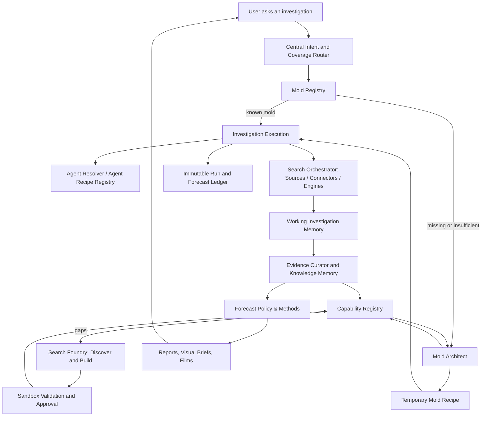

# Master Architecture — The Injection Machine

> **MANARA Foundation v1.0 · 2026-10-18 · Design specification, not implemented software.**
> Canonical source: `https://github.com/mayakilzy/repo-info/tree/main/AgentCraft-MANARA`.
> Code only: `https://github.com/mayakilzy/AgentCraft-MANARA`.
> General standards: `https://github.com/mayakilzy/repo-info/tree/main/START-HERE`.

## Logical diagram

## Core engine: one versioned codebase
- API and authenticated multi-tenant project/workspaces; job runner and resumable workflows.
- Routing, source discovery, search adapter execution, extraction, validation, provenance, evidence curation, forecast method selection and publication interfaces.
- Registries: Source, Connector, Search Capability, Mold Recipe, Agent Recipe, capability tests/evaluations.
- Evidence store with relationships, temporal snapshots, archive/checksums; cross-domain semantic and keyword retrieval.
- Publishing modules and analytics on evidence/provenance; commercial layer later.

## Boundaries
**Source** is provider/dataset/website/document collection. **Connector** is tested implementation of access/extraction with rate limits/auth/licensing. **Search Engine/Capability** is a semantic domain-specific query plan/profile using one or more connectors, selectors, extraction policies and output schema. **Mold** is a versioned sector/research orchestration recipe. **Agent** executes tasks via authorized capabilities; not the source of truth. **Investigation** is a run with its own temporary evidence state and outputs.

## Integration model
One service/process initially (modular monolith) + PostgreSQL + object storage + optional pgvector + simple worker/job execution. Choose Python backend with FastAPI and TypeScript React/Vite UI as a **proposed default**, subject to inspected AADS. No forced Kafka/Redis queue/Neo4j/K8s/many microservices; add components only after load/evidence justify.

## Package discipline
Information files and missions live in `repo-info/AgentCraft-MANARA`. Runtime code lives in `AgentCraft-MANARA`. Shared Toolkit is READ-ONLY. Minimal internal interfaces; make extensions through contracts and registry, not forked service code. Deep plugins may be needed for domain-specific forecasting but must not mutate core contracts.

## Operational states
Foundry: `discovered → assessed → candidate → sandbox_tested → review_pending → approved` or `rejected/quarantined/degraded/retired`. No unapproved dynamic source code in production. Mold: `temporary → reusable → maintained → archived`. Agent: `on_demand → recipe_saved → tested → maintained / retired`; an inactive retained recipe consumes no permanent worker process.
