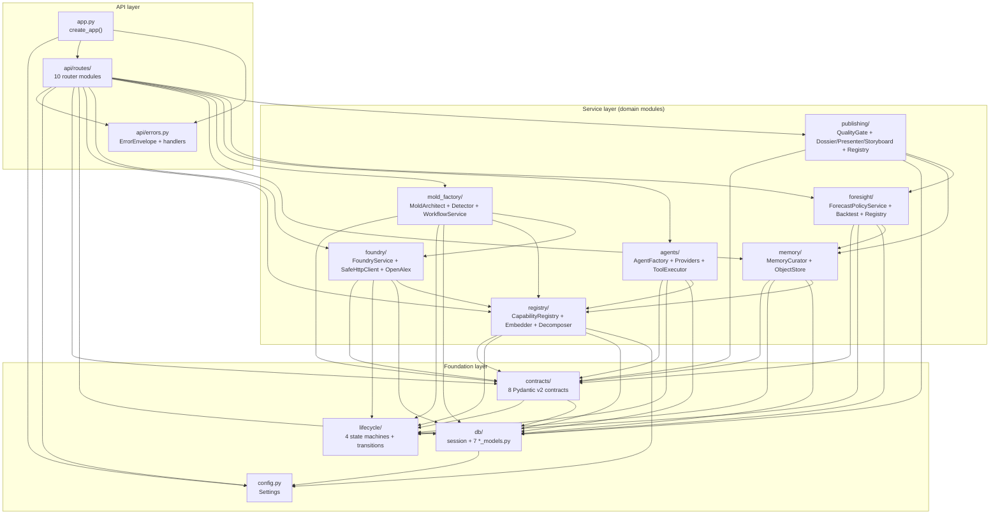
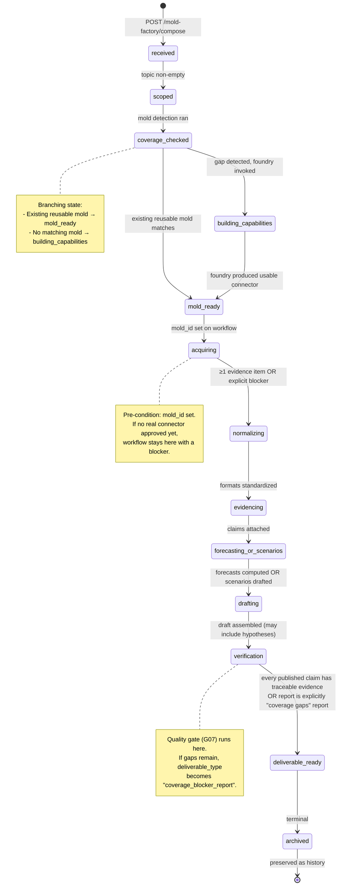
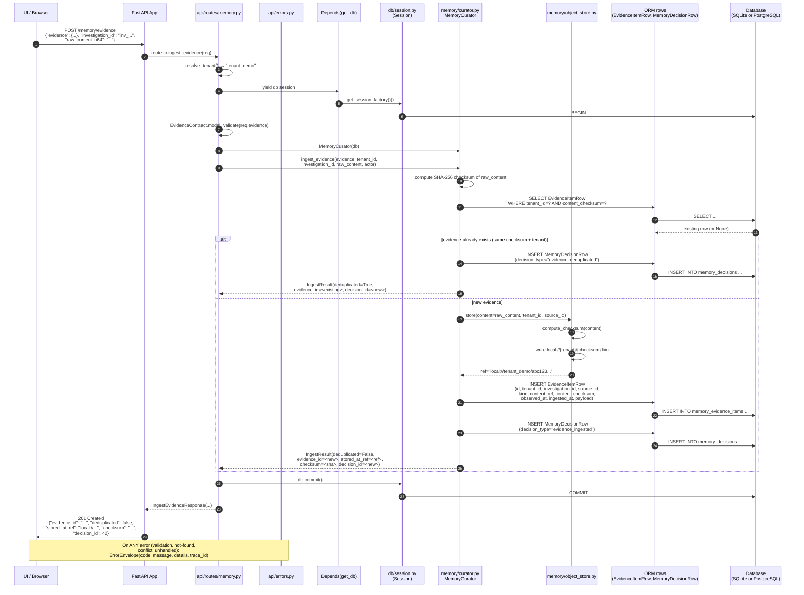

# MANARA Backend Architecture

> **Audience:** UI/UX design team with no prior backend experience.
> **Goal:** Read this once and understand every endpoint, every data shape,
> every state transition, and every honest limitation well enough to design
> screens that consume the MANARA API.
> **Code source:** `backend/src/manara/`
> **Doc status:** Generated by reading the actual code on 2026-10-19.

---

## 1. Overview

### 1.1 What MANARA is

MANARA — the **Adaptive Intelligence Factory** — is a research intelligence
backend that turns natural-language research questions ("study the future of
intelligent prosthetics") into evidence-led, traceable, contestable research
deliverables. It is **not** a chatbot. It is a structured pipeline that:

1. Discovers, assesses, and approves external data sources (Foundry).
2. Catalogues searchable capabilities over those sources (Registry).
3. Composes investigation molds from those capabilities (Mold Factory).
4. Spins up ephemeral specialist agents to extract evidence (Agent Factory).
5. Curates evidence, claims, and measures in a cumulative knowledge memory
   (Memory Curator).
6. Produces quantitative forecasts with bitemporal safety (Foresight Engine).
7. Renders the evidence into downloadable dossiers, presenter editions, and
   visual storyboards (Publishing Engine).

The whole system is **tenant-scoped**: every row in every table carries a
`tenant_id`, and every query filters by it. In the current G00–G07 mission
band the deployment is single-tenant (`tenant_demo`), but the schema and
service layer are designed so multi-tenant onboarding is a configuration
flip — not a rewrite.

### 1.2 Modular monolith architecture

MANARA is a **modular monolith**: one FastAPI process, one database, one
deployment unit — but the codebase is partitioned into domain modules with
explicit public APIs. Each module exposes its surface via an `__init__.py`
with a curated `__all__` list, so the only way another module can use it is
through its documented interface.

```
backend/src/manara/
├── __init__.py            # Package metadata
├── app.py                 # FastAPI app factory (create_app + lifespan)
├── cli.py                 # manara-migrate / manara-dev / manara-test
├── config.py              # pydantic-settings Settings class
├── py.typed               # PEP 561 marker
├── contracts/             # 8 Pydantic v2 contracts (authoritative schema)
├── lifecycle/             # 4 state machines + transition tables
├── api/                   # 10 route files + uniform error envelope
├── db/                    # session + 7 *_models.py modules
├── registry/              # Capability registry + embeddings + decomposer
├── foundry/               # Source discovery + safe_http + OpenAlex
├── memory/                # Curator + object store (local + S3 stub)
├── mold_factory/          # Architect + detector + workflow
├── agents/                # Factory + providers + tool_executor
├── foresight/             # engine.py (PolicyService, Forecaster, Backtest, Registry)
└── publishing/            # engine.py (QualityGate + 3 builders + Registry)
```

There is no message bus, no Celery worker, no microservice boundary. The
service layer classes (`CapabilityRegistry`, `FoundryService`,
`MemoryCurator`, `MoldArchitect`, `EphemeralAgentRuntime`,
`ForecastPolicyService`, `PublicationRegistry`) are plain Python classes
constructed per-request with a SQLAlchemy `Session`. This means:

- **Frontend calls are synchronous** — the HTTP request blocks until the
  service finishes. There is no job-status endpoint to poll.
- **No background workers exist** — long-running tasks (live LLM calls, real
  OpenAlex queries) WILL block the request for their full duration.
- **All state lives in the database** — refresh the page and the same data
  comes back. There is no in-memory cache the UI must invalidate.

### 1.3 What the UI team MUST know before designing anything

| Topic | Decision |
|---|---|
| **Auth** | None implemented. Every router returns `settings.default_tenant_id` from a private `_resolve_tenant()` helper. The UI MUST NOT show per-user workspaces; there is only one tenant today. |
| **Error shape** | One uniform `ErrorEnvelope` for all errors. See §3.2. |
| **IDs** | String IDs everywhere (e.g. `search.academic-publications`, `mold.recycling-2026-001`). They are stable, lowercase, dotted. The UI may parse on `.` for breadcrumb display. |
| **Timestamps** | Every entity has `created_at` and `updated_at` (UTC, ISO 8601 with `+00:00`). Some entities carry `observed_at`, `ingested_at`, `published_at`, `archived_at` — each has bitemporal semantics (§7.2). |
| **Languages** | Arabic + English are first-class. Capability cards carry `keywords_ar` AND `keywords_en`. The UI MUST plan for RTL from day one. |
| **Pagination** | `limit` + `offset` query params. No cursor pagination yet. Max `limit=200` on most endpoints. |
| **HTTP verbs** | `GET`, `POST`, `PATCH`, `DELETE`. `OPTIONS` allowed by CORS. `PUT` is NOT used anywhere. |

---

## 2. Module Map

Each module is a Python package under `src/manara/`. The map below lists
every directory and its one-line purpose.

### 2.1 `contracts/` — 8 Pydantic v2 contracts

```
src/manara/contracts/
├── __init__.py          # Re-exports + json_schemas() helper
├── source.py            # Source — provider/dataset identity (the "what")
├── connector.py         # Connector — tested access implementation (the "how")
├── search_capability.py # SearchCapability — logical query plan (the "why")
├── domain_mold.py       # Mold — versioned orchestration recipe
├── agent_recipe.py      # AgentRecipe — rehydratable specialist worker recipe
├── evidence.py          # Evidence — traceable, time-aware, contestable claim
├── forecast.py          # Forecast — immutable-at-publication forecast record
└── investigation.py     # Investigation — research run with state machine
```

Every contract carries a `schema_version` string (currently `"1.0.0"` for
all eight) so future migrations can detect stale records. Every contract
uses `ConfigDict(extra="forbid")` — unknown fields are rejected, never
silently dropped. The eight contracts are:

1. **`Source`** — canonical identity of a data provider (OpenAlex, Crossref,
   arXiv). Composed of `SourceIdentity` + `SourceDiscovery` + `SourceGovernance`.
2. **`Connector`** — a tested implementation of access/extraction against a
   Source (e.g. `openalex-v1`). Has `ConnectorExecution` (endpoint, allowed
   hosts, credentials_ref) + `ConnectorGovernance` + `ConnectorTests`.
3. **`SearchCapability`** — the logical "engine" the registry surfaces.
   Composed of identity + discovery + execution + governance + graph +
   evaluations. This is the primary card the UI displays in the registry
   browser.
4. **`Mold`** — a domain orchestration recipe composing one or more
   `capability_ids` and optionally `agent_recipe_ids` into a declarative
   plan. Has `MoldScope` (domain, intent, geography, deliverables) and
   `MoldComposition` (capability IDs, plan steps).
5. **`AgentRecipe`** — a specialist worker recipe (role, system_prompt,
   permitted_tools, model_compatibility, retention, tests). Rehydratable
   for future investigations — the runtime is ephemeral, the recipe
   survives.
6. **`Evidence`** — a traceable evidence item (quote/span/data/sample/
   checksum/figure) with `kind`, `source_id`, `tenant_id`, `claims`,
   `measures`, and a `Provenance` block carrying `observed_at`,
   `ingested_at`, `valid_from`/`valid_to`, `was_derived_from`, etc.
7. **`Forecast`** — an immutable-at-publication forecast record. Status
   `draft` → `published` (immutable) → `superseded` by a new forecast
   referencing the original via `subsequent_revision_of`.
8. **`Investigation`** — a research run with its own state machine, scope,
   mold recipe reference, agent recipe references, evidence IDs, forecast
   IDs, and an append-only `checkpoints` list.

> **UI hint:** The full JSON Schema for all eight contracts is served at
> `GET /contracts/schemas`. Use it for TypeScript type generation.

### 2.2 `lifecycle/` — 4 state machines

```
src/manara/lifecycle/
├── __init__.py
└── states.py    # FoundryState, MoldState, AgentState, InvestigationState
                 # + FOUNDRY_TRANSITIONS, MOLD_TRANSITIONS,
                 #   AGENT_TRANSITIONS, INVESTIGATION_TRANSITIONS
```

Each state is a `str, Enum`. Each transition table is a
`dict[State, set[State]]` mapping a state to the set of states it may
transition into. These are intentionally small enums (not a state-machine
library) — see §5 for the full transition tables.

### 2.3 `config.py` — pydantic-settings

```
src/manara/config.py
```

A single `Settings(BaseSettings)` class with `SettingsConfigDict(env_file=".env",
case_sensitive=False, extra="ignore")`. Key fields the UI team should know
about:

```python
env: Literal["development", "staging", "production"]      # MANARA_ENV
database_url: str                                          # DATABASE_URL
default_tenant_id: str = "tenant_demo"                     # MANARA_DEFAULT_TENANT_ID
single_tenant_demo: bool = True                            # MANARA_SINGLE_TENANT_DEMO
discovery_mode: Literal["synthetic", "live"] = "synthetic" # MANARA_DISCOVERY_MODE
frontend_base_url: str = "http://localhost:5173"            # FRONTEND_BASE_URL
```

The `is_sqlite` property returns `True` when `database_url` starts with
`sqlite`. The `/status` endpoint reports this honestly as `database_url_kind:
"sqlite" | "postgres"` so the UI can show a "dev mode" badge.

### 2.4 `app.py` — FastAPI app factory

```
src/manara/app.py
```

Exports `create_app()` and a module-level `app = create_app()` for
`uvicorn manara.app:app`. The factory:

1. Builds a `FastAPI` with title/description/version from `config.py`.
2. Adds `CORSMiddleware` (permissive for `http://localhost:5173` and
   `127.0.0.1:5173` — your Vite dev server).
3. Registers the uniform error handlers (see §3.2).
4. Mounts 10 routers: `status`, `discovery`, `contracts`, `registry`,
   `foundry`, `memory`, `mold_factory`, `agents`, `foresight`, `publishing`.
5. Adds a root `GET /` endpoint returning app name + version + doc links.

A `lifespan` async context manager auto-creates SQLite tables on startup
(via `Base.metadata.create_all`) when the configured DB is SQLite. In
PostgreSQL production the schema is created by Alembic migrations only.

### 2.5 `api/` — 10 route files + uniform error envelope

```
src/manara/api/
├── __init__.py
├── errors.py              # ErrorEnvelope + ManaraError hierarchy + handlers
└── routes/
    ├── __init__.py
    ├── status.py          # GET /status, GET /health
    ├── discovery.py       # GET /discovery (synthetic)
    ├── contracts.py      # GET /contracts/schemas
    ├── registry.py       # /registry/* (12 endpoints)
    ├── foundry.py        # /foundry/* (8 endpoints)
    ├── memory.py         # /memory/* (12 endpoints)
    ├── mold_factory.py   # /mold-factory/* (9 endpoints)
    ├── agents.py         # /agents/* (11 endpoints)
    ├── foresight.py      # /foresight/* (7 endpoints)
    └── publishing.py     # /publishing/* (4 endpoints)
```

Total: **73 endpoints** across 10 routers. Every router has a private
`_resolve_tenant()` that returns `settings.default_tenant_id` (see §7.1
honest gap). Each route handler:

1. Resolves the tenant.
2. Resolves the database session via `Depends(get_db)`.
3. Instantiates the appropriate service class (`CapabilityRegistry(db)`,
   `FoundryService(db)`, etc.).
4. Calls the service method.
5. Serializes the result (Pydantic `.model_dump(mode="json")`).
6. Returns it (FastAPI wraps in `JSONResponse`).

### 2.6 `db/` — session.py + 7 `*_models.py` modules

```
src/manara/db/
├── __init__.py            # Re-exports every *Row class + helpers
├── session.py             # Base, get_engine, get_session_factory, get_db, init_db, reset_engine
├── models.py              # InvestigationRow (G00)
├── registry_models.py     # SourceRow, ConnectorRow, CapabilityRow, CapabilityEvaluationRow,
│                          #   CapabilityRelationshipRow, ApprovalRow, CapabilityEmbeddingRow (G01)
├── memory_models.py       # EvidenceItemRow, ClaimRow, ClaimSupportEdgeRow, MeasureRow,
│                          #   EntityRow, EntityRelationRow, HypothesisRow, SourceSnapshotRow,
│                          #   MemoryDecisionRow, InvestigationReuseRow (G03)
├── mold_models.py         # MoldRecipeRow, GapAnalysisRow, MoldReuseRow, InvestigationWorkflowRow (G04)
├── agent_models.py        # AgentRecipeRow, AgentSessionRow, AgentEvaluationRow (G05)
├── foresight_models.py    # ForecastRow, ForecastOutcomeRow, BacktestResultRow (G06)
└── publishing_models.py   # PublicationRow, PublicationClaimRow, StoryboardSceneRow (G07)
```

The Pydantic contracts (§2.1) are the **authoritative schema**. The ORM rows
mirror them but denormalize key fields (e.g. `domains_json`,
`keywords_ar_json`, `tags_json`) for fast filtering. The full Pydantic
contract is preserved verbatim in a `payload: JSON` column on every row.

### 2.7 `alembic/versions/` — 7 migrations

```
backend/alembic/versions/
├── 0001_initial.py        # investigations (G00)
├── 0002_registry.py       # 7 registry tables (G01)
├── 0003_memory.py         # 10 memory tables (G03)
├── 0004_molds.py          # 4 mold tables (G04)
├── 0005_agents.py         # 3 agent tables (G05)
├── 0006_foresight.py      # 3 foresight tables (G06)
└── 0007_publishing.py     # 3 publishing tables (G07)
```

Total: **31 physical tables** across 7 migrations. (The mission spec
referenced "~30 tables"; the actual count is 31 — see §9 for the honest
discrepancy note.) Each migration is forward-only; Alembic downgrades are
not authored.

### 2.8 `registry/` — capability registry + embeddings + decomposer

```
src/manara/registry/
├── __init__.py
├── embeddings.py          # Embedder + NumpyEmbeddingStore + PgvectorEmbeddingStore + factory
├── seed_cards.py          # 8 high-quality seed capability cards (G01)
├── decomposer.py          # InvestigationDecomposer: query → research needs (G01-R1)
├── converters.py          # Pydantic ↔ ORM conversion (source_to_row, row_to_source, ...)
└── service.py             # CapabilityRegistry (CRUD + 5-stage retrieval pipeline + multi-coverage)
```

**8 seed capability cards** (loaded via `POST /registry/capabilities/seed`):

| Card ID | Domain |
|---|---|
| `search.academic-publications` | academic, research |
| `search.patent-intelligence` | industry, IP |
| `search.clinical-trials` | medical, regulatory |
| `search.energy-ev-datasets` | energy, EV |
| `search.agricultural-statistics` | agriculture, FAOSTAT |
| `search.geopolitical-events` | events, GDELT |
| `search.waste-recycling-statistics` | waste, OECD |
| `search.github-activity` | technology, OSS |

The `Embedder` class wraps `paraphrase-multilingual-MiniLM-L12-v2` (384-dim,
multilingual — see §4). It is a process-level singleton; the first call
loads the model from disk (~120 MB).

The `NumpyEmbeddingStore` stores 384-float vectors as JSON arrays in
`registry_capability_embeddings.vector_json`. Similarity search loads ALL
vectors for `(tenant_id, kind)` into memory and computes cosine similarity
in numpy. This is fine for the dev seed (≤ ~3k vectors); production switches
to `PgvectorEmbeddingStore` — **but see §9.1 for the honest gap**.

The `InvestigationDecomposer` splits a natural-language query into research
needs (`scientific_literature`, `patent_intelligence`,
`clinical_evidence`, `technology_signals`, `market_data`,
`policy_indicators`, `event_tracking`, `environmental_data`) using
keyword + probe-embedding scoring. NOT an LLM call — deterministic.

### 2.9 `foundry/` — source discovery + safe HTTP + OpenAlex

```
src/manara/foundry/
├── __init__.py
├── catalog.py             # SourceCandidate dataclass + OPENALEX, CROSSREF, ARXIV constants + CATALOG list
├── safe_http.py           # validate_url + SafeHttpClient + SsrfViolation + FoundryRequestConfig
├── openalex_connector.py  # OpenAlexConnector (real API adapter)
└── service.py             # FoundryService (discover → assess → register → sandbox-test → approve)
```

The catalog ships three candidate sources today:

- `OPENALEX` — owner-approved first real source (CC0-1.0, no auth needed).
- `CROSSREF` — future candidate (not yet sandbox-tested).
- `ARXIV` — future candidate (not yet sandbox-tested).

The `SafeHttpClient` is the SSRF-protected HTTP wrapper used by every
outbound network call. It enforces:

- URL scheme ∈ `("https",)` by default.
- Hostname must be in the per-client `allowed_hosts` list.
- DNS resolution must NOT return private IPs (`10.`, `127.`, `172.16-31.`,
  `192.168.`, `169.254.`, `::1`, `fe80:`, `fc00:`/`fd00:`).
- No userinfo in URL (no embedded credentials).
- No fragment in URL.
- Redirects are NOT followed automatically — the caller must explicitly
  invoke `follow_redirect()` which re-validates the target.
- Response `Content-Type` must match one of `expected_content_types`
  (default: `application/json`). Mismatch raises `SsrfViolation` — this is
  a hard failure (per BACKEND-VERIFICATION-01 F3).

The `OpenAlexConnector` is the only real connector today. It targets
`https://api.openalex.org/works` and exposes:

- `search_works(query, filters, per_page)` — full-text + structured search.
- `get_work(openalex_id)` — single work fetch.

Every call is recorded with `openalex_id`, `publication_year`,
`cited_by_count`, and the request timestamp — so the UI can show provenance
for every retrieved work.

### 2.10 `memory/` — curator + object store

```
src/manara/memory/
├── __init__.py
├── curator.py            # MemoryCurator (ingest, claim, promote, search_prior, reuse, snapshot, at-cutoff)
└── object_store.py       # ObjectStoreProtocol + LocalFilesystemStore + S3CompatibleStore + factory
```

The `MemoryCurator` is the **cumulative knowledge brain**. It:

- Ingests evidence (deduplicating by SHA-256 checksum + tenant scope).
- Attaches claims with `supports | refutes | qualifies` edges. Multiple
  edges can target the same claim — contradictions are preserved, never
  silently overwritten.
- Promotes claim verdicts: `candidate → supported → contested → refuted →
  superseded`. Each promotion creates an audit `MemoryDecisionRow`.
- Searches prior memory for reusable evidence (with freshness assessment).
- Records investigation-to-investigation reuse links.
- Captures source response snapshots (content-addressed by SHA-256).
- Enforces bitemporal safety (see §7.2): `observed_at` ≤ `ingested_at`,
  and the cutoff replay (`/memory/investigations/{id}/at-cutoff`) refuses
  to surface evidence ingested after the cutoff.

The object store is swappable via `MANARA_OBJECT_STORE` env var:

- `local` (default) → `LocalFilesystemStore` writes to `var/snapshots/`.
- `s3` → `S3CompatibleStore` (stub — see §9 for the honest gap).

Every snapshot reference is `local://{tenant_id}/{checksum}` or
`s3://{bucket}/{tenant_id}/{checksum}`. Content-addressed = idempotent.

### 2.11 `mold_factory/` — architect + detector + workflow

```
src/manara/mold_factory/
├── __init__.py
├── architect.py          # MoldArchitect + three-tier CoverageLevel enum
├── detector.py           # UnknownDomainDetector
└── workflow.py           # InvestigationWorkflowService + WorkflowTransitionError
```

The `MoldArchitect` composes a temporary mold for a research query by:

1. Calling `UnknownDomainDetector.detect()` to see if an existing reusable
   or maintained mold already covers the query's domain.
2. Calling `InvestigationDecomposer.decompose_query()` to split the query
   into research needs.
3. For each need, finding matching capabilities in the registry.
4. For each matching capability, classifying it into one of **three coverage
   tiers** (G04-R1 owner decision):

   | Level | Meaning |
   |---|---|
   | `NONE` | No capability card matches the need. |
   | `CATALOG` | A capability card exists, but no approved connector is linked. |
   | `OPERATIONAL` | Card exists AND at least one connector is `status="approved"`. |
   | `VERIFIED` | OPERATIONAL + the connector has a successful sandbox test record. |

5. Auto-records `GapAnalysisRow` entries when a need has no OPERATIONAL
   coverage.
6. Sets `is_complete=True` ONLY when every need has OPERATIONAL+ coverage.
7. Sets `deliverable_type="coverage_blocker_report"` when operational gaps
   exist (NOT `"research_deliverable"` — honest gap reporting).

The `InvestigationWorkflowService` enforces the 13-state investigation state
machine (see §5.4 + the mermaid diagram in §8.2). It validates
pre-conditions per state and records a `blocker` field when a transition
cannot advance. The audit trail (`transitions_json`) is append-only.

### 2.12 `agents/` — factory + providers + tool_executor

```
src/manara/agents/
├── __init__.py
├── factory.py            # GeneralistVsSpecialistResolver + AgentRecipeRegistry + EphemeralAgentRuntime + ToolPermissionResolver
├── providers.py          # LLMProvider protocol + MockProvider + ZAIProvider + get_provider factory
└── tool_executor.py     # ToolExecutor protocol + NoOpToolExecutor + RegistryToolExecutor + parse_tool_calls
```

The Agent Factory follows the spec's "phone book for shift workers" model:

- **`AgentRecipeRegistry`** — CRUD for recipes (the phone book). Recipes
  survive their sessions and can be rehydrated from cold.
- **`GeneralistVsSpecialistResolver`** — decides whether the general analyst
  suffices or a specialist is needed (clinical, patent, etc.).
- **`ToolPermissionResolver`** — computes the INTERSECTION of:
  capability permissions × investigation context × agent recipe. The agent
  CANNOT grant itself additional tools.
- **`EphemeralAgentRuntime`** — instantiates a recipe, executes via the LLM
  provider (mock or live), records the session + evaluation, terminates.

Two provider implementations:

- **`MockProvider`** — deterministic, returns structured mock responses. The
  `is_mock=True` flag is ALWAYS set so the UI can show a "MOCK" badge.
- **`ZAIProvider`** — stub for Z.AI/GLM integration. Requires
  `MANARA_ZAI_API_KEY` env var. **NOT tested in the sandbox** — see §9.2.

The `tool_executor.py` module was ADDED in BACKEND-VERIFICATION-01
(previously tools were recorded but never invoked — see §9.5). It exposes:

- `ToolInvocation` dataclass (`tool_name`, `arguments`, `status`, `result`,
  `error`, `timestamp`).
- `ToolExecutor` protocol with `invoke(tool_name, arguments,
  granted_tools, tenant_id, investigation_id)`.
- `NoOpToolExecutor` — records attempted invocations but does not execute.
- `RegistryToolExecutor` — dispatches to real MANARA services:
  - `registry.search` → `CapabilityRegistry.search()`
  - `memory.search_prior` → `MemoryCurator.search_prior_memory()`
  - `foundry.search_openalex` → gated by `RUN_LIVE_TESTS=1`
- `parse_tool_calls(llm_text)` — parses `TOOL_CALL: <name> {json}` lines
  emitted by the LLM.

### 2.13 `foresight/` — engine.py

```
src/manara/foresight/
├── __init__.py
└── engine.py    # ForecastPolicyService + BaselineForecaster + BacktestEngine + ForecastRegistry
```

The Foresight Engine is the forecasting policy layer. It:

1. **`ForecastPolicyService`** — the Central Forecast Router. Selects the
   forecasting methodology based on evidence availability:
   - Sufficient time-series → `trend_ets` or `arima`.
   - Hierarchical adoption data → `hierarchical_adoption`.
   - Calibrated probabilities available → `calibrated_probability`.
   - Bayesian priors → `bayesian_update`.
   - TRL data → `technology_readiness_scenario`.
   - Insufficient evidence → `insufficient_evidence` (refuses to fabricate).
2. **`BaselineForecaster`** — naive + seasonal naive baselines for
   comparison. Every forecast MUST be compared against a baseline.
3. **`BacktestEngine`** — historical replay with bitemporal leakage
   prevention. Refuses to use any `DataPoint` whose `published_at` exceeds
   the cutoff. The `leakage_detected` flag is surfaced to the UI.
4. **`ForecastRegistry`** — persistence + immutability enforcement. Once
   `status="published"`, the row is immutable. Revisions create a new row
   with `subsequent_revision_of` pointing to the original; the original's
   `superseded_by` is set to the new row. `try_modify_published_forecast()`
   is exposed as a regression test endpoint (always returns `False`).

### 2.14 `publishing/` — engine.py

```
src/manara/publishing/
├── __init__.py
└── engine.py    # QualityGate + DossierBuilder + PresenterEditionBuilder + StoryboardBuilder + PublicationRegistry
```

The Publishing Engine renders the SAME evidence base into three output
types (per owner: "Single Evidence Dossier → Multiple Output Renderers"):

1. **Research Dossier** — structured report with sections, executive summary,
   findings, contradictions, gaps, forecasts, monitoring indicators, and
   references.
2. **Presenter Edition** — 3–5 minute media script with cue sheet, editor
   notes, and timing computed from word count × speech rate (NOT a fixed
   claim of "5 minutes").
3. **Visual Storyboard** — scene-by-scene visual plan with explicit
   `scene_type` classification: `evidence_backed_factual`,
   `data_visualization`, `scientific_reconstruction`,
   `scenario_illustration`, `fictional_scene`. Fictional scenes MUST carry a
   `disclosure_text` — never presented as documentary.

The `QualityGate` enforces 6 rejection rules before publication. If any
rule fails, the publication is created with `quality_gate_passed=False`,
`downloadable=False`, and `quality_gate_issues` lists the rejections. The UI
must show these issues prominently — the user can read the issues but cannot
download a failed publication.

The `PublicationRegistry` exposes `download(pub_id, format)` returning the
content in `json`, `markdown`, or `text` format with proper
`Content-Type` and `Content-Disposition: attachment; filename="..."`
headers. Arabic content is UTF-8 encoded.

---

## 3. The API Surface (what the UI calls)

### 3.1 Router prefixes + endpoint counts

| Router | Prefix | Endpoints |
|---|---|---|
| `status` | (root) | 2: `GET /status`, `GET /health` |
| `discovery` | `/discovery` | 1: `GET /discovery` |
| `contracts` | `/contracts` | 1: `GET /contracts/schemas` |
| `registry` | `/registry` | 12: capabilities CRUD, search, search/coverage, evaluations, relationships, reindex |
| `foundry` | `/foundry` | 8: candidates list, discover, assess, register-connector, sandbox-test, approve, quarantine |
| `memory` | `/memory` | 12: evidence ingest/get/list, claims attach/support/promote, prior search, reuse, decisions, snapshots, at-cutoff |
| `mold_factory` | `/mold-factory` | 9: compose, list/get molds, promote, archive, gaps, workflow create/transition/get |
| `agents` | `/agents` | 11: recipes list/get/seed/seed/promote, resolve, sessions create/execute/terminate/evaluate/get |
| `foresight` | `/foresight` | 7: assess, forecasts create/publish/revise/try-modify/backtest, get |
| `publishing` | `/publishing` | 4: create, list, get, download |

**Total: 73 endpoints.** All return JSON (except `GET /publishing/.../download`
which returns a file with `Content-Disposition: attachment`).

### 3.2 The uniform error envelope

EVERY error response — whether a 404, a 422 validation error, a 409
conflict, a 503 service-unavailable, or a 500 unhandled exception — is
serialized into the same shape:

```python
class ErrorEnvelope(BaseModel):
    code: str                          # snake_case machine code (e.g. "not_found")
    message: str                       # human-readable summary
    details: dict | list | None        # optional structured context (e.g. validation errors)
    trace_id: str | None               # x-request-id or x-trace-id header value
```

The error hierarchy (`manara.api.errors`):

```python
ManaraError                  # base, code="manara_error", http_status=500
├── NotFoundError            # code="not_found",                http_status=404
├── ValidationError          # code="validation_error",         http_status=422
├── ConflictError            # code="conflict",                 http_status=409
└── ServiceUnavailableError  # code="service_unavailable",      http_status=503
```

Plus two framework-level handlers:

- `RequestValidationError` (FastAPI's built-in 422 for bad payloads) →
  `ErrorEnvelope(code="validation_error", details=[...pydantic errors...])`.
- `Exception` (any unhandled exception) →
  `ErrorEnvelope(code="internal_error", message="Internal server error.")`.
  In production the message is generic; in development it includes the
  exception type name. NEVER leaks the raw exception text in production.

> **UI design rule:** Build ONE error toast/banner component that consumes
> `ErrorEnvelope`. Display `message` to the user, log `code` + `trace_id`
> to the monitoring system, and expand `details` when the user clicks
> "show technical details".

### 3.3 Example: a typical request flow

`POST /mold-factory/compose` with body
`{"query": "study the future of intelligent prosthetics"}`:

1. FastAPI routes to `mold_factory.compose_mold()`.
2. The handler calls `_resolve_tenant()` → returns `"tenant_demo"`.
3. The handler resolves `db: Session` via `Depends(get_db)`.
4. It instantiates `MoldArchitect(db)`.
5. `architect.compose_mold(query, tenant_id, ...)` runs:
   - `UnknownDomainDetector.detect()` → searches `mold_recipes` for
     reusable/maintained molds matching the query.
   - `decompose_query(query, embedder=Embedder.get())` → returns 3–5
     detected research needs.
   - For each need, finds matching capabilities in the registry, classifies
     each into NONE/CATALOG/OPERATIONAL/VERIFIED, records gaps.
   - Persists a new `InvestigationRow` (if `investigation_id` not provided).
   - Persists a new `MoldRecipeRow` with `state="temporary"`.
   - Persists `GapAnalysisRow` entries for every unmet need.
6. The handler returns `ComposeMoldResponse(...)` as JSON.

The UI receives:

```json
{
  "query": "study the future of intelligent prosthetics",
  "investigation_id": "inv_a1b2c3...",
  "is_unknown_domain": true,
  "detection_reasoning": "No existing reusable/maintained mold matched.",
  "detected_needs": [
    {"need": "scientific_literature", "label_en": "Scientific literature & citations", "relevance": 0.83},
    {"need": "patent_intelligence", "label_en": "Patent intelligence & IP trends", "relevance": 0.71},
    {"need": "clinical_evidence", "label_en": "Clinical evidence & regulatory pathways", "relevance": 0.65},
    {"need": "technology_signals", "label_en": "Technology signals & code activity", "relevance": 0.42}
  ],
  "coverage": [
    {"need": "scientific_literature", "capability_id": "search.academic-publications", "coverage_level": "OPERATIONAL"},
    {"need": "patent_intelligence", "capability_id": "search.patent-intelligence", "coverage_level": "OPERATIONAL"},
    {"need": "clinical_evidence", "capability_id": "search.clinical-trials", "coverage_level": "CATALOG"},
    {"need": "technology_signals", "capability_id": "search.github-activity", "coverage_level": "OPERATIONAL"}
  ],
  "gaps": [
    {"need": "clinical_evidence", "status": "open", "resolution_notes": "Connector not yet approved."}
  ],
  "mold_recipe_id": "mold.intelligent-prosthetics-...",
  "mold": { /* full Mold contract */ },
  "is_complete": false,
  "is_catalog_complete": false,
  "deliverable_type": "coverage_blocker_report",
  "composition_notes": "..."
}
```

The UI must therefore design for:

- A **needs list** (left rail) showing detected needs with relevance scores.
- A **coverage matrix** (center) showing need × capability × coverage level.
- A **gaps list** (right rail) showing what could not be satisfied.
- A **deliverable type banner**: if `deliverable_type ==
  "coverage_blocker_report"`, the UI must NOT pretend the investigation
  produced a research deliverable — it produced a coverage gap report.

---

## 4. Persistence Layer

### 4.1 SQLAlchemy 2.x ORM + Alembic migrations

The ORM uses SQLAlchemy 2.x typed `Mapped[...]` + `mapped_column(...)`
declarations exclusively. The declarative base is in `db/session.py`:

```python
class Base(DeclarativeBase):
    """Declarative base for all MANARA ORM models."""
```

The engine is a per-process singleton (`get_engine()`), with
SQLite-specific `check_same_thread=False` for FastAPI workers and
Postgres-specific `pool_size` + `max_overflow` for production. The session
factory uses `autoflush=False, autocommit=False, expire_on_commit=False`
so Pydantic contract round-trips don't trigger lazy loads after commit.

### 4.2 SQLite dev / PostgreSQL 16 + pgvector prod

| Aspect | SQLite (dev) | PostgreSQL 16 + pgvector (prod) |
|---|---|---|
| Driver | `sqlite:///./manara_dev.db` | `postgresql+psycopg://...` |
| Connection pool | None (single connection, `check_same_thread=False`) | `pool_size=5, max_overflow=10` |
| Schema creation | `Base.metadata.create_all()` on startup | `alembic upgrade head` (manual) |
| Embedding storage | JSON array in `vector_json` column | JSON + (planned) pgvector `vector` column |
| Embedding search | Numpy in-process cosine | (Planned) pgvector `<=>` cosine + ivfflat index |
| Full-text search | LIKE / ILIKE | (Planned) `tsvector` + GIN index |

The `is_sqlite` property on `Settings` lets every module branch on the
backend. Today this branching exists in three places:

1. `db/session.py` — engine kwargs (`check_same_thread` vs pool).
2. `registry/embeddings.py` — `get_embedding_store()` factory returns
   `NumpyEmbeddingStore` for SQLite, `PgvectorEmbeddingStore` for Postgres.
3. `memory/object_store.py` — `get_object_store()` returns
   `LocalFilesystemStore` for dev, `S3CompatibleStore` for prod (gated by
   `MANARA_OBJECT_STORE` env var, not by `is_sqlite`).

### 4.3 The 31 tables (organized by mission)

**G00 — Foundation (1 table):**

| # | Table | Purpose |
|---|---|---|
| 1 | `investigations` | Tenant-scoped investigation row + full Pydantic payload |

**G01 — Registry (7 tables):**

| # | Table | Purpose |
|---|---|---|
| 2 | `registry_sources` | Canonical Source identity |
| 3 | `registry_connectors` | Tested implementation of access/extraction |
| 4 | `registry_capabilities` | Logical search engine cards (the UI's primary surface) |
| 5 | `registry_capability_evaluations` | Dated precision/recall/misuse-rate records |
| 6 | `registry_capability_relationships` | Graph edges (`complements`, `specializes`, `replaces`, `conflicts_with`) |
| 7 | `registry_approvals` | Audit trail of owner-approved promotions |
| 8 | `registry_capability_embeddings` | 384-dim MiniLM vectors stored as JSON |

**G03 — Memory (10 tables):**

| # | Table | Purpose |
|---|---|---|
| 9 | `memory_evidence_items` | Quotes/spans/data with checksums + bitemporal timestamps |
| 10 | `memory_claims` | Bounded statements with verdict enum |
| 11 | `memory_claim_support_edges` | supports/refutes/qualifies edges (preserves contradictions) |
| 12 | `memory_measures` | Quantified values with unit + methodology + geography |
| 13 | `memory_entities` | Named entities (org/person/tech/place) |
| 14 | `memory_entity_relations` | Typed edges between entities |
| 15 | `memory_hypotheses` | Investigator suppositions (clearly labeled, NOT claims) |
| 16 | `memory_source_snapshots` | Captured raw API responses (content-addressed) |
| 17 | `memory_decisions` | Append-only audit log (never overwritten) |
| 18 | `memory_investigation_reuse` | Records when investigation B reused A's evidence |

**G04 — Mold Factory (4 tables):**

| # | Table | Purpose |
|---|---|---|
| 19 | `mold_recipes` | Stored Mold contracts with `state` enum |
| 20 | `mold_gap_analyses` | Missing capability records (honest gap reporting) |
| 21 | `mold_reuse` | Records when a recipe was rehydrated for a new investigation |
| 22 | `investigation_workflows` | Workflow state + append-only transition trail |

**G05 — Agents (3 tables):**

| # | Table | Purpose |
|---|---|---|
| 23 | `agent_recipes` | Specialist worker recipes (the "phone book") |
| 24 | `agent_sessions` | Ephemeral execution records |
| 25 | `agent_evaluations` | Per-session evaluation records |

**G06 — Foresight (3 tables):**

| # | Table | Purpose |
|---|---|---|
| 26 | `foresight_forecasts` | Immutable-at-publication forecasts |
| 27 | `foresight_forecast_outcomes` | Observed outcomes (filled when horizon reached) |
| 28 | `foresight_backtest_results` | Historical backtest runs with leakage check |

**G07 — Publishing (3 tables):**

| # | Table | Purpose |
|---|---|---|
| 29 | `publishing_publications` | Published output records (dossier/presenter/storyboard) |
| 30 | `publishing_publication_claims` | Claims cited in a publication, linked to evidence |
| 31 | `publishing_storyboard_scenes` | Visual scenes with evidence/fiction classification |

> **Honest note on count:** The mission spec referenced "~30 tables"; the
> actual count is **31 physical tables** across 7 Alembic migrations. The
> discrepancy is one table (likely the spec was rounding). The UI should
> treat this as "about 30 tables" and use the actual list above for any
> data-browser screen.

### 4.4 The 8 Boolean columns (fixed in BACKEND-VERIFICATION-01)

Prior to BACKEND-VERIFICATION-01, 8 ORM columns were declared as
`Mapped[bool]` (which SQLAlchemy maps to `Boolean`) but their Alembic
migrations declared them as `sa.JSON` (which stores `0`/`1` as JSON-encoded
integers). This caused silent type mismatches: the ORM would read a `1`
back as the integer `1`, not the boolean `True`, breaking `if row.field:`
checks.

The fix (per BACKEND-VERIFICATION-01 F1) updated all 8 migrations to use
`sa.Boolean` with `server_default=sa.text("0")`. The 8 columns are:

| Table | Column | Default |
|---|---|---|
| `mold_reuse` | `modified_during_reuse` | `False` |
| `foresight_forecasts` | `leakage_check_passed` | `False` |
| `foresight_forecast_outcomes` | `correct` | `None` (nullable) |
| `foresight_backtest_results` | `leakage_detected` | `False` |
| `foresight_backtest_results` | `data_cutoff_verified` | `False` |
| `publishing_publications` | `quality_gate_passed` | `False` |
| `publishing_publications` | `downloadable` | `False` |
| `publishing_publication_claims` | `verified` | `False` |

The UI can therefore trust that these fields are real booleans, not
integers-in-disguise.

---

## 5. State Machines

All four state machines live in `src/manara/lifecycle/states.py`. Each is
a `str, Enum` plus a `dict[State, set[State]]` transition table.

### 5.1 Foundry State Machine

For Source, Connector, and SearchCapability entities. 10 states, 10 entries
in the transition table.

**States:**

| State | Meaning |
|---|---|
| `discovered` | Found in the catalog, not yet assessed. |
| `assessed` | Basic structural checks passed. |
| `candidate` | Suitable for sandbox testing. |
| `sandbox_tested` | One real permitted API call succeeded. |
| `review_pending` | Sandbox test passed; awaiting owner approval. |
| `approved` | Owner-approved for production use. |
| `rejected` | Terminal — failed assessment or review. |
| `quarantined` | Degraded — failed test or revoked. Recoverable. |
| `degraded` | Approved-but-failing; can be retired or restored. |
| `retired` | Terminal — removed from active use. |

**Transitions (`FOUNDRY_TRANSITIONS`):**

```python
{
    DISCOVERED:     {ASSESSED, REJECTED},
    ASSESSED:        {CANDIDATE, REJECTED},
    CANDIDATE:       {SANDBOX_TESTED, QUARANTINED},
    SANDBOX_TESTED:  {REVIEW_PENDING, QUARANTINED},
    REVIEW_PENDING:  {APPROVED, REJECTED, DEGRADED},
    APPROVED:        {DEGRADED, RETIRED},
    REJECTED:        set(),                 # terminal
    QUARANTINED:     {CANDIDATE, RETIRED},  # recoverable
    DEGRADED:        {RETIRED, APPROVED},   # restorable
    RETIRED:         set(),                 # terminal
}
```

### 5.2 Mold State Machine

For Mold recipe entities. 4 states.

**States:**

| State | Meaning |
|---|---|
| `temporary` | Composed on-demand; survives its investigation. |
| `reusable` | Saved as a recipe; can be rehydrated. |
| `maintained` | Version-pinned, periodically re-validated. Requires `last_piloted_at`. |
| `archived` | Preserved as history; no longer executes. |

**Transitions (`MOLD_TRANSITIONS`):**

```python
{
    TEMPORARY: {REUSABLE, ARCHIVED},
    REUSABLE:  {MAINTAINED, ARCHIVED},
    MAINTAINED:{ARCHIVED},
    ARCHIVED:  set(),              # terminal
}
```

### 5.3 Agent State Machine

For AgentRecipe entities. 5 states.

**States:**

| State | Meaning |
|---|---|
| `on_demand` | Default state — not yet saved as a recipe. |
| `recipe_saved` | Persisted to the registry. |
| `tested` | Has evaluation evidence (`tests.last_evaluation_outcome` set). |
| `maintained` | Tested + explicit `security_review` set. |
| `retired` | Terminal — no longer instantiated. |

**Transitions (`AGENT_TRANSITIONS`):**

```python
{
    ON_DEMAND:    {RECIPE_SAVED},
    RECIPE_SAVED: {TESTED, RETIRED},
    TESTED:       {MAINTAINED, RETIRED},
    MAINTAINED:   {RETIRED},
    RETIRED:      set(),                  # terminal
}
```

### 5.4 Investigation State Machine

For Investigation entities. **13 states.** This is the most complex machine
in the system. See the mermaid diagram in §8.2 for the visual.

**States (in canonical order):**

| # | State | Meaning |
|---|---|---|
| 1 | `received` | Investigation created; awaiting scope. |
| 2 | `scoped` | Topic refined; awaiting coverage check. |
| 3 | `coverage_checked` | Mold detection ran; awaiting mold readiness. |
| 4 | `building_capabilities` | Foundry invoked to fill a gap. |
| 5 | `mold_ready` | Mold recipe exists and is operational. |
| 6 | `acquiring` | Mold executing; collecting evidence. |
| 7 | `normalizing` | Standardizing evidence formats. |
| 8 | `evidencing` | Claims being attached to evidence. |
| 9 | `forecasting_or_scenarios` | Forecasts being computed OR scenarios drafted. |
| 10 | `drafting` | Publication draft being assembled. |
| 11 | `verification` | Quality gate being applied. |
| 12 | `deliverable_ready` | Quality gate passed; publication ready. |
| 13 | `archived` | Terminal — preserved as history. |

**Transitions (`INVESTIGATION_TRANSITIONS`):**

```python
{
    RECEIVED:                  {SCOPED},
    SCOPED:                    {COVERAGE_CHECKED},
    COVERAGE_CHECKED:          {BUILDING_CAPABILITIES, MOLD_READY},
    BUILDING_CAPABILITIES:     {MOLD_READY},
    MOLD_READY:                {ACQUIRING},
    ACQUIRING:                 {NORMALIZING},
    NORMALIZING:               {EVIDENCING},
    EVIDENCING:                {FORECASTING_OR_SCENARIOS},
    FORECASTING_OR_SCENARIOS:  {DRAFTING},
    DRAFTING:                  {VERIFICATION},
    VERIFICATION:              {DELIVERABLE_READY},
    DELIVERABLE_READY:         {ARCHIVED},
    ARCHIVED:                  set(),                # terminal
}
```

**Pre-conditions enforced by `InvestigationWorkflowService`:**

| Transition | Pre-condition |
|---|---|
| `received → scoped` | Non-empty topic. |
| `scoped → coverage_checked` | Mold detection has run. |
| `coverage_checked → mold_ready` | An existing reusable mold matches, OR `coverage_checked → building_capabilities` if a gap exists. |
| `building_capabilities → mold_ready` | Foundry produced a usable connector. |
| `mold_ready → acquiring` | `mold_id` is set on the workflow row. |
| `acquiring → normalizing` | At least one evidence item OR an explicit `blocker`. |
| `drafting → verification` | Drafts may include hypotheses without evidence (clearly labeled). |
| `verification → deliverable_ready` | Every published claim has traceable evidence OR the report is explicitly a "coverage gaps" report. |

When a transition cannot advance, the service sets `blocker` on the
workflow row and returns `transitioned=False`. The UI must show the
blocker prominently — it is NOT a silent failure.

---

## 6. Embedding Model

### 6.1 The model

```python
EMBEDDING_MODEL_NAME    = "paraphrase-multilingual-MiniLM-L12-v2"
EMBEDDING_MODEL_VERSION = "v1-2026-10-18"   # bump when re-training
EMBEDDING_DIM           = 384
```

This is a sentence-transformers model that:

- Outputs **384-dimensional** L2-normalized vectors.
- Is **multilingual** — handles English and Arabic (plus 50+ other
  languages) in the same vector space. This is what enables the
  "prosthetics" query to match `search.clinical-trials` (English) AND
  `search.patent-intelligence` (English keywords + Arabic keywords) without
  cross-lingual bridging.
- Loads from `~/.cache/huggingface/` (or `/home/z/my-project/.models/` if
  `SENTENCE_TRANSFORMERS_HOME` is set) on first use (~120 MB download).
- After that, in-memory as a process-level singleton via
  `Embedder.get()` (thread-safe double-checked locking).

### 6.2 The store abstraction

Two implementations of `EmbeddingStoreProtocol`:

**`NumpyEmbeddingStore`** (SQLite dev):

```python
def store_embedding(db, *, capability_id, tenant_id, kind, vector, source_text, example_index=None):
    row = CapabilityEmbeddingRow(
        capability_id=capability_id,
        tenant_id=tenant_id,
        kind=kind,                          # description | positive_example | negative_example | combined
        example_index=example_index,
        model_name=EMBEDDING_MODEL_NAME,
        model_version=EMBEDDING_MODEL_VERSION,
        embedding_dim=len(vector),           # 384
        vector_json=[float(x) for x in vector.tolist()],   # stored as JSON array
        source_text=source_text,
    )
    db.add(row); db.flush()
    return row

def search_similar(db, *, query_vector, tenant_id, kind="combined", top_k=20, min_similarity=0.0):
    # Loads ALL embeddings of (tenant_id, kind) into memory,
    # builds an (N, 384) numpy matrix, computes cosine = dot product
    # (vectors are L2-normalized), filters by min_similarity, takes top_k.
```

**`PgvectorEmbeddingStore`** (PostgreSQL prod — **STUB**, see §9.1):

```python
def store_embedding(db, ...):
    # Delegates to NumpyEmbeddingStore().store_embedding(...)
    # (the pgvector column write is OMITTED in the sandbox)

def search_similar(db, ...):
    # In production this would issue:
    #   SELECT *, 1 - (vector <=> :q) AS sim
    #   FROM registry_capability_embeddings
    #   WHERE tenant_id = :t AND kind = :k
    #     AND 1 - (vector <=> :q) >= :min_sim
    #   ORDER BY vector <=> :q LIMIT :top_k
    # In the sandbox, FALLS BACK to NumpyEmbeddingStore().search_similar(...)
```

### 6.3 The "combined" embedding text

The canonical embedding for a capability card is built from a multilingual
concatenation of its key fields:

```python
def build_combined_text(*, display_name, description_long, domains, tags,
                        keywords_en, keywords_ar, synonyms, positive_examples):
    parts = [display_name, description_long]
    if domains: parts.append("Domains: " + ", ".join(domains))
    if tags: parts.append("Tags: " + ", ".join(tags))
    if keywords_en: parts.append("Keywords (en): " + ", ".join(keywords_en))
    if keywords_ar: parts.append("Keywords (ar): " + ", ".join(keywords_ar))
    if synonyms: parts.append("Synonyms: " + ", ".join(synonyms))
    if positive_examples:
        parts.append("Sample intents:")
        for ex in positive_examples[:8]:        # capped to keep focused
            parts.append(f"  - {ex}")
    return "\n".join(parts)
```

> **UI hint:** When a user searches `/registry/search?q=...`, the query is
> embedded with the SAME model and compared against the `combined`
> embeddings. The UI can show "matched by keywords" vs "matched by
> semantics" using the `text_similarity` and `semantic_similarity` fields
> on each `CapabilitySearchHit`.

---

## 7. Cross-cutting Concerns

### 7.1 Tenant isolation (every query filtered by `tenant_id`)

Every ORM row carries `tenant_id: Mapped[str] = mapped_column(String(120),
index=True, nullable=False)`. Every service-layer query filters by it. For
example, `CapabilityRegistry.list_capabilities()`:

```python
def list_capabilities(self, *, tenant_id, domains=None, tags=None, statuses=None, limit=50, offset=0):
    stmt = select(CapabilityRow).where(CapabilityRow.tenant_id == tenant_id)
    if domains: stmt = stmt.where(CapabilityRow.domains_json.contains(domains))
    if tags: stmt = stmt.where(CapabilityRow.tags_json.contains(tags))
    if statuses: stmt = stmt.where(CapabilityRow.status.in_(statuses))
    stmt = stmt.order_by(CapabilityRow.updated_at.desc()).limit(limit).offset(offset)
    return list(self.db.execute(stmt).scalars())
```

Cross-tenant queries are impossible at the ORM level — there is no
`list_all_tenants()` method anywhere. The tenant is resolved at the API
layer by `_resolve_tenant()` (currently returns `settings.default_tenant_id`
— see §9.3 honest gap). When multi-tenant auth lands (planned post-G03),
the resolver will read from the auth token, not from settings.

The `delete_for_capability()` method in `EmbeddingStoreProtocol` was
hardened in BACKEND-VERIFICATION-01 F4 to require `tenant_id` when the
caller knows it (defense in depth — even though the service layer has
already verified ownership, the store SHOULD NOT delete rows belonging to
a different tenant).

### 7.2 Bitemporal safety (`published_at` vs `observed_at`)

The Evidence contract carries a `Provenance` block with **two distinct
timestamps**:

| Field | Meaning |
|---|---|
| `observed_at` | World-time — when the event described by the evidence actually happened in the world. |
| `published_at` | When the source published this data. May be later than `observed_at`. |
| `ingested_at` | Knowledge-time — when MANARA learned of it. MUST be ≥ `observed_at`. |
| `valid_from` / `valid_to` | When the evidence is/was valid in the world. |
| `known_at` | When MANARA's internal clock first considered this evidence "known". |
| `revision_at` / `withdrawn_at` | When the source revised or withdrew the data. |

The Pydantic `Evidence._validate()` model validator enforces:

```python
if self.provenance.observed_at is not None and self.provenance.ingested_at < self.provenance.observed_at:
    raise ValueError("ingested_at must be >= observed_at (knowledge-time >= world-time)")
```

The `MemoryCurator.get_evidence_at_cutoff()` method implements **bitemporal
replay**: given a cutoff datetime, return only evidence whose
`ingested_at ≤ cutoff`. This is what backtests use to avoid future
leakage. The endpoint `POST /memory/investigations/{id}/at-cutoff` exposes
this to the UI.

The `BacktestEngine.run_backtest()` method additionally checks every
`DataPoint.published_at` against the cutoff:

```python
leaked = [dp for dp in all_data_points if dp.published_at and dp.published_at > cutoff_date]
result.leakage_detected = len(leaked) > 0
result.leaked_evidence_ids = [dp.source_id for dp in leaked]
```

> **UI design rule:** When showing evidence in a timeline view, distinguish
> `observed_at` (when it happened) from `ingested_at` (when MANARA saw
> it). In a backtest context, dim or hide evidence whose `ingested_at` is
> after the cutoff — it was NOT available at the simulated time.

### 7.3 Immutability (published forecasts)

A `Forecast` row with `status="published"` is immutable. The
`ForecastRegistry.try_modify_published_forecast()` method exists ONLY as a
regression-test endpoint — it always returns `False`, and the
`POST /foresight/forecasts/{id}/try-modify` endpoint surfaces this
honestly. The actual immutability is enforced at the service layer:

```python
def try_modify_published_forecast(self, *, forecast_id, tenant_id, new_point_estimate) -> bool:
    row = self.db.get(ForecastRow, forecast_id)
    if row is None or row.tenant_id != tenant_id:
        return False
    if row.status != "published":
        return False
    # REFUSE to mutate the published row.
    return False
```

To revise a published forecast, the user must call
`POST /foresight/forecasts/{id}/revise`, which:

1. Creates a NEW `ForecastRow` with `status="draft"`.
2. Sets `subsequent_revision_of` on the new row to the original's ID.
3. Sets `superseded_by` on the original to the new row's ID.
4. Sets `status="superseded"` on the original.

The original is preserved unchanged. The UI can therefore show a revision
history tree — every published forecast links backward to its original and
forward to its superseder.

### 7.4 Contradiction preservation (`refutes` doesn't delete)

The `ClaimSupportEdgeRow` table stores typed edges between evidence and
claims:

```python
relation: Mapped[str] = mapped_column(String(20), nullable=False)
# supports | refutes | qualifies
```

Multiple edges can target the same claim. When evidence B `refutes` a claim
that evidence A `supports`, BOTH edges are preserved. The
`MemoryCurator.add_support_edge()` method never deletes existing edges —
it appends a new one. The claim's `verdict` transitions through
`candidate → supported → contested → refuted → superseded` as the cumulative
evidence shifts, but the original supporting edges remain in the database
forever.

```python
# MemoryCurator.add_support_edge()
edge = ClaimSupportEdgeRow(
    tenant_id=tenant_id,
    claim_id=claim_id,
    evidence_id=evidence_id,
    relation=relation,       # supports | refutes | qualifies
    weight=weight,
    notes=notes,
)
self.db.add(edge)
self.db.flush()
# NO deletion of existing edges here — contradictions are preserved.
```

> **UI design rule:** When displaying a claim, show ALL support edges
> (supporting, refuting, qualifying) in separate columns. NEVER collapse
> them into a single "consensus" view that hides the disagreement.

### 7.5 Audit log (append-only, never overwritten)

The `memory_decisions` table is the audit log. Every state change in the
memory layer (ingestion, claim promotion, supersession, contradiction,
hypothesis update, evidence reuse, deduplication, snapshot expiration)
creates a new `MemoryDecisionRow`. No row is ever deleted or updated.

```python
class MemoryDecisionRow(Base):
    __tablename__ = "memory_decisions"
    id: Mapped[int] = mapped_column(Integer, primary_key=True, autoincrement=True)
    tenant_id: Mapped[str] = mapped_column(String(120), index=True, nullable=False)
    decision_type: Mapped[str] = mapped_column(String(40), nullable=False, index=True)
    # evidence_ingested | claim_promoted | claim_superseded | claim_contradicted
    # | hypothesis_opened | hypothesis_tested | evidence_reused
    # | evidence_deduplicated | snapshot_expired
    investigation_id: Mapped[str | None] = mapped_column(String(120), nullable=True, index=True)
    evidence_id: Mapped[str | None] = mapped_column(String(120), nullable=True, index=True)
    claim_id: Mapped[str | None] = mapped_column(String(120), nullable=True, index=True)
    actor: Mapped[str] = mapped_column(String(120), nullable=False)  # user | curator | system
    rationale: Mapped[str] = mapped_column(Text, nullable=False, default="")
    payload: Mapped[dict[str, Any]] = mapped_column(JSON, nullable=False, default=dict)
    decided_at: Mapped[datetime] = mapped_column(DateTime(timezone=True), default=lambda: datetime.now(UTC))
```

The endpoint `GET /memory/investigations/{id}/decisions` returns the audit
log for an investigation, ordered by `decided_at DESC`. The UI should
display this as an immutable timeline — never editable.

---

## 8. Diagrams

### 8.1 Module dependency graph (who imports whom)

This diagram shows the import graph between MANARA's internal packages.
Arrow direction = "depends on". The foundational layer (`contracts`,
`lifecycle`, `config`, `db`) is imported by everyone; the API layer sits
at the top; service modules in the middle.



### 8.2 Investigation state machine

The 13-state investigation workflow with all transitions. Branching happens
after `coverage_checked`: if a mold already exists, the workflow goes
straight to `mold_ready`; otherwise it dips through `building_capabilities`
(foundry invoked) and then to `mold_ready`.



### 8.3 Request flow (API → service → DB → response)

A canonical end-to-end flow for `POST /memory/evidence` (ingesting a new
piece of evidence). The same pattern applies to every write endpoint;
read endpoints skip the audit-log write.



---

## 9. Honest Gaps

The MANARA team is committed to NEVER fabricating capabilities. The
following are confirmed limitations as of BACKEND-VERIFICATION-01.

### 9.1 `PgvectorEmbeddingStore` is a STUB

`registry/embeddings.py` defines `PgvectorEmbeddingStore` as a class with
the correct method signatures, but every method delegates to
`NumpyEmbeddingStore`:

```python
class PgvectorEmbeddingStore:
    def store_embedding(self, db, *, capability_id, tenant_id, kind, vector, ...):
        # Delegates to NumpyEmbeddingStore().store_embedding(...)
        # The actual pgvector column write is OMITTED in the sandbox.
        return NumpyEmbeddingStore().store_embedding(db, ...)

    def search_similar(self, db, *, query_vector, tenant_id, kind, top_k, min_similarity):
        # Falls back to NumpyEmbeddingStore().search_similar(...)
        # (would issue SELECT ... ORDER BY vector <=> :q in real prod)
        return NumpyEmbeddingStore().search_similar(db, ...)
```

**Implication for the UI:** semantic search works correctly today (it uses
the numpy fallback), but it does NOT scale beyond ~10k embeddings. If the
registry grows past that, search latency will degrade visibly. When true
pgvector is wired in (post-G08), the UI behavior will not change — the
backend swap is invisible.

### 9.2 `ZAIProvider` is a STUB requiring `MANARA_ZAI_API_KEY`

`agents/providers.py` defines `ZAIProvider` for Z.AI/GLM integration, but
it requires `MANARA_ZAI_API_KEY` to be set in the environment, and it has
NOT been exercised in the sandbox (no API key available). The provider
factory `get_provider()` returns `MockProvider` unless the env var is set
AND a connection check passes.

**Implication for the UI:** Today, every agent session will have
`execution_mode="mock"` and `is_mock=True`. The UI MUST show a "MOCK
EXECUTION" badge on every agent session card. When the live provider is
wired in, the badge will disappear — no UI changes required.

### 9.3 Multi-tenant authentication is NOT implemented at the API layer

Every router file (`registry.py`, `foundry.py`, `memory.py`,
`mold_factory.py`, `agents.py`, `foresight.py`, `publishing.py`) has a
private `_resolve_tenant()` helper:

```python
def _resolve_tenant() -> str:
    """In G01 we still ship single-tenant demo mode; multi-tenant arrives
    in G03. The tenant_id is therefore the default tenant from settings.
    """
    return settings.default_tenant_id
```

There is no JWT, no API key, no session cookie. The UI MUST NOT show
per-user workspaces or per-user audit logs — there is only ONE tenant
(`tenant_demo`) and ONE shared audit log today.

When multi-tenant auth lands (planned post-G03), the resolver will read
from the auth token. The rest of the stack (services, ORM, queries) is
already tenant-scoped, so the change is localized to one helper per
router file.

### 9.4 8 Boolean columns were FIXED in BACKEND-VERIFICATION-01

Prior to BACKEND-VERIFICATION-01, 8 ORM columns declared as
`Mapped[bool]` had matching Alembic migrations that declared them as
`sa.JSON` (storing `0`/`1` as JSON integers). This caused silent type
mismatches: `if row.quality_gate_passed:` would be truthy for the integer
`1` but the boolean semantics were lost.

The fix (F1) updated all 8 migrations to use `sa.Boolean` with
`server_default=sa.text("0")`. The 8 columns are listed in §4.4. The UI
can now trust these are real booleans.

### 9.5 `ToolExecutor` scaffold was ADDED in BACKEND-VERIFICATION-01

Prior to BACKEND-VERIFICATION-01, `EphemeralAgentRuntime.execute()` only
called `provider.generate()` and stored the text response. Tools were
recorded in `granted_tools_json` but NEVER invoked at runtime.

The fix (F5) added `agents/tool_executor.py` with:

- `ToolInvocation` dataclass.
- `ToolExecutor` protocol.
- `NoOpToolExecutor` (records but does not execute — for tests).
- `RegistryToolExecutor` that dispatches to real MANARA services:
  - `registry.search` → `CapabilityRegistry.search()`
  - `memory.search_prior` → `MemoryCurator.search_prior_memory()`
  - `foundry.search_openalex` → gated by `RUN_LIVE_TESTS=1`
- `parse_tool_calls(llm_text)` parses `TOOL_CALL: <name> {json}` lines.

`EphemeralAgentRuntime.execute()` now:

1. Injects the granted tools into the system prompt.
2. Asks the LLM to emit tool calls in the structured format.
3. Parses tool calls from the response.
4. Dispatches each through `ToolExecutor` (which enforces the granted set).
5. Records each invocation (executed, denied, not_implemented, or error)
   in `tool_invocations_json`.

**Implication for the UI:** Agent session detail pages now have a
"Tool Invocations" tab showing each attempted tool call with its status.
The UI should show:

- ✅ executed (green) — tool ran successfully.
- ❌ denied_not_in_granted_set (red) — agent tried to call a tool it
  wasn't granted. Security event.
- ⚠️ not_implemented (amber) — tool name recognized but not in the
  dispatch table. Honest gap.
- ⛔ error (red) — tool raised an exception. Recorded, not raised.

### 9.6 Additional honest gaps (from the `/status` endpoint)

The `GET /status` endpoint enumerates these "not implemented" items
honestly. The UI team should be aware of each:

| Gap | Mission |
|---|---|
| `real_forecasting` | G06 (current forecasts use baseline methods only) |
| `real_publishing` | G07 (publishing engine exists but not production-hardened) |
| `full_ux_integration` | G08 (THIS IS YOUR MISSION) |
| `production_deployment` | G09 |
| `multi_tenant_authn` | post-G03 |
| `object_storage_s3_exercised` | code present, no S3 creds in sandbox |
| `pgvector_index_ivfflat` | present in code, NOT exercised (see §9.1) |
| `additional_real_connectors` | G02 ships OpenAlex only; Crossref + arXiv pending |
| `live_search_verified` | only single-work GET verified; search blocked by rate limit |
| `memory_vector_search` | future: pgvector-backed semantic retrieval over evidence |
| `foundry_auto_connector_generation` | G04 records gaps; auto-build is G05+ territory |
| `live_llm_execution` | mock provider only; Z.AI requires API key (see §9.2) |
| `live_clinical_assessment` | mock responses; not a real clinical evaluation |

---

## 10. UI Design Implications (cheat sheet)

A condensed list of design decisions the UI team should make based on the
architecture above.

### 10.1 Navigation structure

The 10 routers map naturally to 10 top-level navigation sections:

| Nav section | Router | Primary entity displayed |
|---|---|---|
| Status | `/status` | Build info + capability list + not-implemented list |
| Discovery | `/discovery` | One synthetic capability card |
| Contracts | `/contracts/schemas` | 8 JSON schemas (developer reference) |
| Registry | `/registry/*` | Capability cards (the primary browse surface) |
| Foundry | `/foundry/*` | Source candidates + sandbox test results |
| Memory | `/memory/*` | Evidence + claims + audit log |
| Mold Factory | `/mold-factory/*` | Mold recipes + workflow state |
| Agents | `/agents/*` | Recipes + sessions + evaluations |
| Foresight | `/foresight/*` | Forecasts + backtests |
| Publishing | `/publishing/*` | Publications + downloads |

### 10.2 Universal UI patterns

- **Tenant badge:** Today shows "tenant_demo" in the corner. When
  multi-tenant lands, this becomes a tenant switcher.
- **State badges:** Use the enums directly. `discovered`, `assessed`,
  `candidate`, `sandbox_tested`, `review_pending`, `approved` for foundry
  entities. Color-code: gray (discovered), blue (assessed/candidate),
  amber (sandbox_tested/review_pending), green (approved), red
  (rejected/quarantined/degraded), dark gray (retired).
- **Coverage badges:** NONE (red), CATALOG (amber), OPERATIONAL (green),
  VERIFIED (green-check). This is the most important visual signal in the
  Mold Factory — users MUST understand at a glance whether their question
  can actually be answered.
- **MOCK badge:** Every agent session card carries `is_mock`. When true,
  show a prominent "MOCK EXECUTION" badge.
- **Bitemporal tooltips:** When showing evidence, hover on the timestamp
  to reveal both `observed_at` and `ingested_at`.
- **Arabic + RTL:** The capability cards carry `keywords_ar` AND
  `keywords_en`. The UI MUST support RTL layout from day one.
- **Download buttons:** Only enabled when `downloadable=True` on the
  publication row. The `quality_gate_passed=False` state must be shown
  with the `quality_gate_issues` list before any download button.
- **Error toasts:** One component consuming `ErrorEnvelope`. Display
  `message` prominently, `code` as a small chip, `trace_id` in a
  collapsible "technical details" section.

### 10.3 Investigation workflow visualization

The 13-state investigation state machine is the most complex UI surface.
Recommendation:

- A horizontal stepper showing all 13 states.
- The current state highlighted.
- Past states checked off.
- Future states grayed out.
- When `blocker` is non-null, show a red warning icon on the current
  state with the blocker text in a tooltip.
- A separate "Transition Audit Trail" tab showing the append-only
  `transitions_json` list with timestamps, actors, and rationales.

### 10.4 The three-tier coverage matrix

For `POST /mold-factory/compose`, the response includes `coverage` (list
of need × capability × coverage_level) and `gaps` (list of unmet needs).
Recommendation:

- Render as a matrix: rows = needs, columns = capabilities, cells = color
  by coverage level.
- Below the matrix, render the gaps list with status chips (`open`,
  `foundry_invoked`, `foundry_no_candidate`, `resolved`, `unresolved`).
- The header banner must show `deliverable_type`:
  - `research_deliverable` → green "Ready" badge.
  - `coverage_blocker_report` → amber "Partial" badge with tooltip
    "This investigation produced a coverage gap report, not a research
    deliverable."

### 10.5 Publication download UX

`GET /publishing/publications/{id}/download?format=json|markdown|text`
returns a file attachment. Recommendation:

- Three download buttons: JSON, Markdown, Text.
- Before enabling them, check `downloadable: True` on the publication.
- If `quality_gate_passed: False`, disable all three buttons and show
  the `quality_gate_issues` list as a modal "Why can't I download
  this?".
- The filename is derived from the title (sanitized to alphanumeric +
  dash + underscore, max 60 chars) + `.{format}`.

---

## 11. Glossary

| Term | Definition |
|---|---|
| **Agent** | An ephemeral runtime worker instantiated from an `AgentRecipe` for a single task. |
| **AgentRecipe** | A persisted specialist worker recipe (the "phone book entry"). Survives its sessions. |
| **Bitemporal** | Tracking both when an event happened (`observed_at`) and when MANARA learned of it (`ingested_at`). |
| **Capability** | A logical search engine card in the Registry. References zero or more Connectors. |
| **Connector** | A tested implementation of access/extraction against a Source (e.g. `openalex-v1`). |
| **Contract** | A Pydantic v2 model that defines the authoritative schema for a domain entity. |
| **Coverage level** | Three-tier model: NONE / CATALOG / OPERATIONAL / VERIFIED. |
| **Curator** | The `MemoryCurator` service — the cumulative knowledge brain. |
| **Dossier** | A structured research report produced by the Publishing Engine. |
| **Embedding** | A 384-dim L2-normalized vector from `paraphrase-multilingual-MiniLM-L12-v2`. |
| **Evidence** | A traceable item (quote/span/data/sample/checksum/figure) with provenance. |
| **Forecast** | An immutable-at-publication forecast record. |
| **Foundry** | The source discovery + sandbox testing + promotion pipeline. |
| **Mold** | A versioned orchestration recipe composing capabilities into a research plan. |
| **Probe embedding** | A pre-computed embedding of a canonical research-need description, used by the Decomposer. |
| **Provenance** | A `Provenance` block on Evidence carrying bitemporal timestamps + W3C-PROV-like edges. |
| **Registry** | The compounding-asset store of capability cards. |
| **Sandbox test** | A single real permitted API call to a candidate source, recorded with provenance. |
| **Source** | A canonical provider/dataset identity (e.g. OpenAlex, Crossref, arXiv). |
| **State machine** | A `str, Enum` + `dict[State, set[State]]` transition table in `lifecycle/states.py`. |
| **Tenant** | The isolation boundary. Today: `tenant_demo`. |
| **Tool permission** | The intersection of capability × investigation × agent-recipe tools. |
| **Workflow** | An `InvestigationWorkflowRow` tracking an investigation's state + audit trail. |

---

## 12. File reference (quick lookup)

Every file the UI team might need to cross-reference, grouped by module.

```
src/manara/
├── __init__.py                            # Package metadata
├── app.py                                 # create_app(), CORS, lifespan, router mounting
├── cli.py                                 # manara-migrate / manara-dev / manara-test
├── config.py                              # Settings(BaseSettings), APP_NAME, APP_VERSION, BUILD_INFO
├── py.typed                               # PEP 561 marker
│
├── contracts/
│   ├── __init__.py                        # Re-exports + json_schemas()
│   ├── source.py                          # Source, SourceIdentity, SourceDiscovery, SourceGovernance
│   ├── connector.py                       # Connector, ConnectorExecution, ConnectorGovernance, ConnectorTests
│   ├── search_capability.py               # SearchCapability, CapabilityGraph, CapabilityEvaluation
│   ├── domain_mold.py                     # Mold, MoldScope, MoldComposition
│   ├── agent_recipe.py                    # AgentRecipe, AgentRetentionPolicy, AgentRecipeTests
│   ├── evidence.py                        # Evidence, EvidenceKind, Claim, ClaimVerdict, ClaimSupport, Measure, Provenance
│   ├── forecast.py                        # Forecast, ForecastBaseline, ForecastEvaluation, ForecastOutcome
│   └── investigation.py                   # Investigation, InvestigationScope, InvestigationCheckpoint
│
├── lifecycle/
│   ├── __init__.py                        # Re-exports
│   └── states.py                          # FoundryState, MoldState, AgentState, InvestigationState + 4 transition tables
│
├── api/
│   ├── __init__.py
│   ├── errors.py                          # ErrorEnvelope, ManaraError, NotFoundError, ValidationError, ConflictError, ServiceUnavailableError, register_error_handlers
│   └── routes/
│       ├── __init__.py
│       ├── status.py                      # GET /status, GET /health
│       ├── discovery.py                   # GET /discovery
│       ├── contracts.py                   # GET /contracts/schemas
│       ├── registry.py                    # 12 endpoints under /registry
│       ├── foundry.py                     # 8 endpoints under /foundry
│       ├── memory.py                      # 12 endpoints under /memory
│       ├── mold_factory.py                # 9 endpoints under /mold-factory
│       ├── agents.py                      # 11 endpoints under /agents
│       ├── foresight.py                   # 7 endpoints under /foresight
│       └── publishing.py                  # 4 endpoints under /publishing
│
├── db/
│   ├── __init__.py                        # Re-exports every *Row class
│   ├── session.py                         # Base, get_engine, get_session_factory, get_db, init_db, reset_engine
│   ├── models.py                          # InvestigationRow (G00)
│   ├── registry_models.py                 # 7 rows (G01)
│   ├── memory_models.py                   # 10 rows (G03)
│   ├── mold_models.py                     # 4 rows (G04)
│   ├── agent_models.py                    # 3 rows (G05)
│   ├── foresight_models.py                # 3 rows (G06)
│   └── publishing_models.py               # 3 rows (G07)
│
├── registry/
│   ├── __init__.py
│   ├── embeddings.py                      # Embedder, EmbeddingStoreProtocol, NumpyEmbeddingStore, PgvectorEmbeddingStore, get_embedding_store, build_combined_text
│   ├── seed_cards.py                      # 8 SearchCapability cards + DOMAIN_SIGNAL_MAP
│   ├── decomposer.py                      # decompose_query(), ARCHETYPES, NEED_TO_CAPABILITIES
│   ├── converters.py                      # source_to_row, row_to_source, connector_to_row, row_to_connector, capability_to_row, row_to_capability, evaluation_to_row
│   └── service.py                         # CapabilityRegistry, CapabilitySearchHit, CapabilitySearchResult, SearchStageTrace
│
├── foundry/
│   ├── __init__.py
│   ├── catalog.py                         # SourceCandidate, OPENALEX, CROSSREF, ARXIV, CATALOG, get_candidate
│   ├── safe_http.py                       # validate_url, SafeHttpClient, SsrfViolation, FoundryRequestConfig
│   ├── openalex_connector.py              # OpenAlexConnector, WorkResult, WorkAuthorship, SearchWorksResponse
│   └── service.py                         # FoundryService, SandboxTestResult, FoundryApprovalResult
│
├── memory/
│   ├── __init__.py
│   ├── curator.py                         # MemoryCurator, IngestResult, ClaimPromotionResult, ReuseSearchResult
│   └── object_store.py                   # ObjectStoreProtocol, LocalFilesystemStore, S3CompatibleStore, get_object_store
│
├── mold_factory/
│   ├── __init__.py
│   ├── architect.py                       # MoldArchitect, CoverageLevel, MoldCompositionResult, NeedCoverage, GapRecord
│   ├── detector.py                        # UnknownDomainDetector, DetectionResult
│   └── workflow.py                        # InvestigationWorkflowService, TransitionResult, WorkflowTransitionError
│
├── agents/
│   ├── __init__.py
│   ├── factory.py                         # GeneralistVsSpecialistResolver, AgentRecipeRegistry, EphemeralAgentRuntime, ToolPermissionResolver, ToolPermissions, create_clinical_prosthetics_reviewer_recipe, create_general_analyst_recipe
│   ├── providers.py                       # LLMProvider, LLMResponse, MockProvider, ZAIProvider, get_provider, reset_provider
│   └── tool_executor.py                   # ToolInvocation, ToolExecutor, NoOpToolExecutor, RegistryToolExecutor, parse_tool_calls
│
├── foresight/
│   ├── __init__.py
│   └── engine.py                          # ForecastPolicyService, BaselineForecaster, BacktestEngine, ForecastRegistry, DataPoint, EvidenceAssessment, ForecastResult, BacktestResult, ForecastMethod
│
└── publishing/
    ├── __init__.py
    └── engine.py                          # QualityGate, QualityGateResult, DossierBuilder, DossierOutput, DossierSection, PresenterEditionBuilder, PresenterOutput, StoryboardBuilder, StoryboardOutput, PublicationRegistry, ClaimType, SceneType
```

---

## 13. Summary for the UI team

1. **MANARA is a modular monolith FastAPI app.** One process, one
   database, no background workers. Every request is synchronous.
2. **There are 73 endpoints across 10 routers.** Each router has a clean
   prefix (`/registry`, `/foundry`, `/memory`, etc.) and uses the uniform
   `ErrorEnvelope` for all errors.
3. **The schema is Pydantic-first.** The 8 contracts in `contracts/` are
   authoritative. The 31 ORM tables mirror them with denormalized columns
   for fast filtering. Use `GET /contracts/schemas` to generate TypeScript
   types.
4. **Today the deployment is single-tenant.** Every router's
   `_resolve_tenant()` returns `"tenant_demo"`. The UI MUST NOT show
   per-user workspaces.
5. **Four state machines drive the lifecycle.** Foundry (10 states),
   Mold (4), Agent (5), Investigation (13). The investigation machine is
   the most complex — see §8.2.
6. **Three-tier coverage is the most important UI signal.** NONE /
   CATALOG / OPERATIONAL / VERIFIED. Users MUST understand at a glance
   whether their question can actually be answered.
7. **Bitemporal timestamps are real.** `observed_at` ≠ `ingested_at`.
   Backtests use the latter to prevent future leakage.
8. **Contradictions are preserved, never silently resolved.** `refutes`
   edges coexist with `supports` edges. The UI must show both.
9. **Published forecasts are immutable.** Revisions create new rows; the
   original is preserved unchanged. Show a revision tree.
10. **Mock execution is honestly labeled.** `is_mock=True` on every agent
    session today. Show a "MOCK EXECUTION" badge.
11. **Several stubs exist.** `PgvectorEmbeddingStore` (delegates to
    numpy), `ZAIProvider` (requires `MANARA_ZAI_API_KEY`),
    `S3CompatibleStore` (requires AWS creds). The UI behavior is
    identical whether the stub or the real backend is active — but the
    UI should be honest about it (e.g. show "dev mode" when
    `database_url_kind == "sqlite"`).

When in doubt, read the `/status` endpoint. It enumerates every
capability actually delivered AND every honest "not implemented" gap. The
UI team should treat that endpoint as the source of truth for "what can
the backend actually do today?"

---

End of document.
