# Investigation Lifecycle — Reference for the UI Design Team

> **Scope.** Single source of truth for how a research question travels
> through the MANARA backend, from the moment a user types it into the
> question box to the moment they click *Download*. Written for the UI
> design team so designers know exactly what to render at every state,
> what user actions are valid, what can go wrong, and what the backend
> will return when something does.
>
> **Backend reference.** Paths below are relative to
> `backend/src/manara/`. State machine: `lifecycle/states.py`.
> Orchestration services live in `mold_factory/`, `foundry/`, `memory/`,
> `agents/`, `foresight/`, `publishing/`. HTTP surface: `api/routes/`.
>
> **Acceptance test.** `backend/tests/test_investigation_lifecycle.py`
> (10 steps covering Question → Publishing → Coverage Blocker). Each
> step maps to a stage documented below (§7).

---

## 0. Owner's Directive — Canonical Stage List

> *Question → Investigation → Needs Analysis → Mold → Operational
> Source Selection → Real Evidence Acquisition → Memory → Analysis →
> Specialist Execution when appropriate → Foresight when appropriate →
> Publishing → Download.*

The owner required: every stage uses the **same investigation ID** (no
shadow IDs mid-pipeline); contradicting evidence is **preserved**,
never silently deleted; the engine **refuses to fabricate** numbers
when evidence is insufficient; the final deliverable is **downloadable
as a real, non-empty file**.

The backend models these stages as a 13-state FSM. The owner's list
and the FSM are *not* identical — the FSM splits a few owner stages
into sub-states so checkpoint hashes can be computed at finer
granularity. The mapping is in §2.

---

## 1. The Investigation State Machine

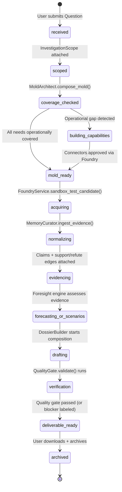

Source: `backend/src/manara/lifecycle/states.py :: INVESTIGATION_TRANSITIONS`.

Key invariants (enforced at the contract layer in
`contracts/investigation.py`):

1. `state` is always one of the 13 enum values; arbitrary strings are
   rejected by Pydantic.
2. The checkpoint history must form a valid walk along the graph — an
   illegal jump raises `ValueError("invalid transition X → Y")` at
   model-validate time.
3. `archived_at` may only be set when `state == archived`; the contract
   auto-sets it on entry into `archived` and rejects manual setting
   elsewhere.
4. Every transition is appended to the workflow's append-only
   `transitions_json` audit trail by
   `InvestigationWorkflowService.transition()`.
5. The workflow service refuses to silently advance when
   pre-conditions fail — it returns
   `TransitionResult(transitioned=False, blocker=...)` rather than
   raising. The blocker string is human-readable and **must** be
   surfaced in the UI.

---

## 2. Owner's Stages → InvestigationState Mapping

| #  | Owner's Stage                    | InvestigationState(s)                                       | Primary Backend Service                                                |
|----|-----------------------------------|-------------------------------------------------------------|------------------------------------------------------------------------|
| 1  | Question                          | `received`                                                  | `db/models.py :: InvestigationRow` (created by MoldArchitect)         |
| 2  | Investigation                     | `received → scoped`                                         | `mold_factory/workflow.py :: InvestigationWorkflowService`            |
| 3  | Needs Analysis                    | `scoped → coverage_checked`                                | `registry/decomposer.py :: decompose_query`, `mold_factory/architect.py :: MoldArchitect` |
| 4  | Mold                              | `coverage_checked → mold_ready`                             | `mold_factory/architect.py :: MoldArchitect.compose_mold`             |
| 5  | Operational Source Selection      | `coverage_checked` (sub-step inside MoldArchitect)         | `mold_factory/architect.py :: _check_coverage_level` (3-tier)         |
| 6  | Real Evidence Acquisition         | `mold_ready → acquiring`                                    | `foundry/service.py :: FoundryService.sandbox_test_candidate`         |
| 7  | Memory                            | `acquiring → normalizing → evidencing`                     | `memory/curator.py :: MemoryCurator.ingest_evidence`                  |
| 8  | Analysis                          | `evidencing` (stays; attaches claims)                      | `memory/curator.py :: attach_claim`, `add_support_edge`               |
| 9  | Specialist Execution (optional)   | runs *during* `evidencing` (no state change)              | `agents/factory.py :: EphemeralAgentRuntime.execute`                  |
| 10 | Foresight (optional)              | `evidencing → forecasting_or_scenarios`                    | `foresight/engine.py :: ForecastPolicyService.assess_evidence`       |
| 11 | Publishing                        | `forecasting_or_scenarios → drafting → verification → deliverable_ready` | `publishing/engine.py :: PublicationRegistry.create_publication`     |
| 12 | Download                          | `deliverable_ready` (no state change; produces a file)      | `publishing/engine.py :: PublicationRegistry.download`                |
| —  | (terminal)                        | `archived`                                                  | `workflow.transition(target_state="archived")`                       |

> "Specialist Execution" and "Foresight" are marked *when appropriate*
> by the owner. The UI must treat them as **optional detours**. The
> canonical path goes `evidencing → drafting` directly when neither
> is invoked.

---

## 3. State-by-State Reference

For each state: backend service / file path, API endpoints, UI display,
valid user actions, failure modes, sequence diagram.

### 3.1 `received` — Owner Stage: Question

**Backend.** `mold_factory/architect.py :: MoldArchitect.compose_mold`
is the **sole** owner of `InvestigationRow` creation (G09-R1). It
generates `inv-<16 hex>`, inserts the row with `state="received"`,
`topic=query[:500]`, and commits before doing further work.

**API.** `POST /mold-factory/compose` (creates the investigation row
as a side-effect). A dedicated `POST /investigations` route is on the
roadmap.

**UI display.** "New Question" input (min 10 chars per
`InvestigationScope.topic` validator), tenant selector (only
`tenant_demo` in dev), "Start Investigation" button (disabled < 10
chars), spinner "Registering investigation…". On success, render the
investigation ID prominently — every subsequent screen must show it.

**Valid actions.** Submit a question (≥ 10 chars); cancel before
submission (no row created).

**Failure modes.**
* Topic < 10 chars → 422 from the Pydantic validator. UI: *"Question
  must be at least 10 characters."*
* DB write failure → 422. UI: *"Could not start investigation. Retry."*
* The state machine refuses to leave `received` until topic is
  non-empty (`workflow._check_preconditions(SCOPED)`).

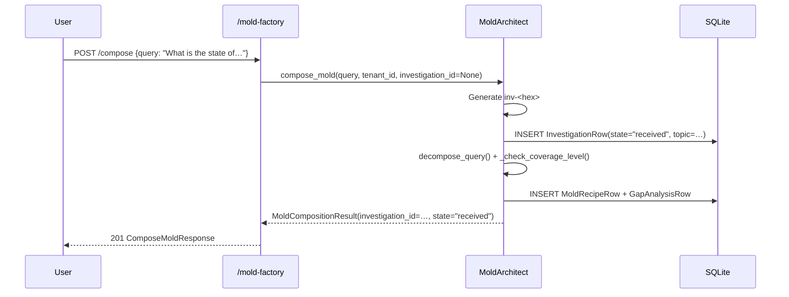

### 3.2 `scoped` — Owner Stage: Investigation

**Backend.** `mold_factory/workflow.py ::
InvestigationWorkflowService.transition`. Pre-condition: non-empty
`topic`. If empty: `blocker="cannot scope: investigation has no topic"`.

**API.**
* `POST /mold-factory/investigations/{id}/workflow` — create workflow row.
* `POST /mold-factory/investigations/{id}/transition` — body
  `{target_state, actor, rationale, mold_id?}`.
* `GET  /mold-factory/investigations/{id}/workflow` — fetch state +
  audit trail.

**UI display.** "Scope" panel: question verbatim (read-only), editable
fields (`horizon_end`, `geography[]`, `languages[]`, `deliverables[]`
defaulting to `["evidence_dossier"]`, `output_language_default`,
`constraints{}`). "Save Scope & Run Needs Analysis" button (disabled
if topic empty). On save: panel collapses, "Scope saved ✓" chip.

**Valid actions.** Edit scope fields; save scope and advance to
`coverage_checked`; cancel and stay in `received`.

**Failure modes.** Empty topic → `TransitionResult.transitioned=False`,
blocker surfaces inline. Network failure during `POST /workflow` →
retry with backoff.

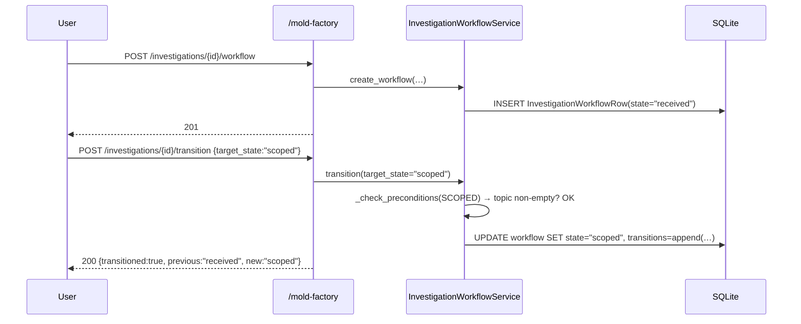

### 3.3 `coverage_checked` — Owner Stages: Needs Analysis + Operational Source Selection

**Backend.** Two owner stages bundled here:

* **Needs Analysis** — `registry/decomposer.py :: decompose_query()`
  splits the question into research needs (`scientific_literature`,
  `patent_intelligence`, `clinical_evidence`, `technology_signals`,
  `market_data`, `policy_indicators`, `event_tracking`,
  `environmental_data`). Uses keyword signals (multilingual ar/en) +
  pre-computed probe embeddings. NOT an LLM call.
* **Operational Source Selection** —
  `mold_factory/architect.py :: MoldArchitect._check_coverage_level()`
  assigns each need one of four coverage levels:
  * `NONE` — no capability card matches the need.
  * `CATALOG` — card exists, no approved connector linked (cannot execute).
  * `OPERATIONAL` — approved connector + approved source linked.
  * `VERIFIED` — operational + connector has `last_verified_at`
    (sandbox test ran successfully).
  Only `OPERATIONAL`/`VERIFIED` capabilities go into
  `composition.capability_ids`. CATALOG-only capabilities are
  auto-recorded as `GapAnalysisRow(status="operational_gap")` — the
  owner requires auto-recording, never manual insertion.

**API.**
* `POST /mold-factory/compose` — returns `ComposeMoldResponse` with
  `detected_needs[]`, `coverage[]`, `gaps[]`, `is_complete`,
  `deliverable_type` (`"research_deliverable"` if `is_complete`,
  else `"coverage_blocker_report"`).
* `GET /mold-factory/molds/{id}/gaps` — list gap analyses.

**UI display.** "Needs Detected" panel: chip per need, colour-coded
(🟢 OPERATIONAL/VERIFIED, 🟡 CATALOG with hover *"Capability exists
but no approved connector yet"*, 🔴 NONE with hover *"No matching
capability in the registry"*). "Gaps" sub-panel listing each
`GapAnalysisRow` with `foundry_resolution` and `resolution_notes`.

**Valid actions.** Re-run needs analysis (idempotent); approve a
connector via `/foundry/...`; quarantine a failed candidate; advance
to `mold_ready` (only if `is_complete=true`) or to
`building_capabilities`.

**Failure modes.**
* Registry returned zero capabilities for any need → that need is
  recorded as a gap with `coverage_level=NONE` (not a crash; UI shows
  the gap prominently).
* Decomposer returned zero needs (extremely unlikely) →
  `ValidationError` from the architect.
* DB constraint violation (duplicate mold_id) →
  `ValidationError("mold composition failed: …")`.

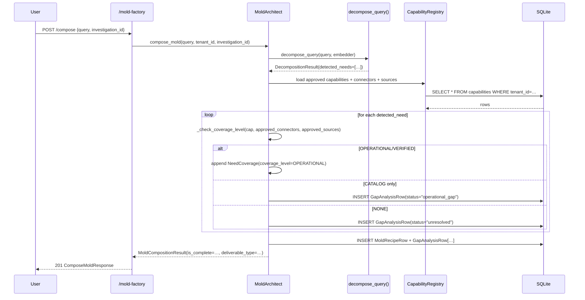

### 3.4 `building_capabilities` — Owner Stage: Mold (detour)

**Backend.** Blocking detour. The investigation cannot proceed to
`mold_ready` until at least one approved connector is linked to each
catalog-only capability. Foundry service is invoked here:

* `foundry/service.py :: FoundryService.discover_candidate()` → state `discovered`.
* `assess_candidate()` → state `assessed` (no network call).
* `register_connector()` → state `candidate`.
* `sandbox_test_candidate(query, per_page)` → executes ONE real
  permitted API call. Promotes connector to `sandbox_tested` on
  success. For OpenAlex, falls back to `get_work("W2741809807")` on
  HTTP 429 (single-work GET, 1 credit vs 10 for search).
* `approve_candidate(reviewer, rationale)` → owner-approved
  promotion. Sets connector and source to `approved`, links
  connector_id to the matching `SearchCapability`, stamps
  `last_verified_at`. This is the action that promotes the
  coverage_level from CATALOG to OPERATIONAL.

**API.**
* `GET /foundry/candidates` — list candidates.
* `POST /foundry/candidates/{id}/discover` → register source row.
* `POST /foundry/candidates/{id}/assess` → structural checks.
* `POST /foundry/candidates/{id}/register-connector`.
* `POST /foundry/candidates/{id}/sandbox-test` → REAL network call.
* `POST /foundry/candidates/{id}/approve` → owner-approved promotion.
* `POST /foundry/candidates/{id}/quarantine`.

**UI display.** "Capabilities Status" panel listing each catalog-only
capability with a "Needs Connector" badge. For each: "Discover in
Foundry" button → candidate list → "Run Sandbox Test" button (modal
shows the real URL, query, expected content-type, spinner, returned
`sample_works`). After sandbox success: "Approve Connector" button
(reviewer + rationale ≥ 10 chars; labelled *"Owner approval required."*).
"Re-check Coverage" button re-runs `MoldArchitect.compose_mold`.

**Valid actions.** Discover / assess / register-connector /
sandbox-test / approve / quarantine candidates; re-run mold
composition; advance to `mold_ready` only when `is_complete=true`.

**Failure modes.**
* Sandbox test fails (network, 4xx/5xx, content-type mismatch) →
  connector NOT promoted to `sandbox_tested`. UI shows
  `SandboxTestResult.error`; offers "Quarantine".
* Approval attempted without prior sandbox test → `ValueError("approval
  requires sandbox_tested or review_pending. Failed approvals cannot
  run.")` → 422. UI: *"Cannot approve a connector that has not been
  sandbox-tested."*
* SSRF violation → `SsrfViolation` from `SafeHttpClient`. Recorded as
  `error` on the SandboxTestResult.
* Content-type mismatch on response → as of BACKEND-VERIFICATION-01
  (Fix F3), this raises `SsrfViolation(rule="unexpected_content_type")`.
  Previously a silent no-op; now a hard failure.

```mermaid
sequenceDiagram
    participant U as User
    participant API as /foundry
    participant FS as FoundryService
    participant SHC as SafeHttpClient
    participant O as api.openalex.org
    participant DB as SQLite
    U->>API: POST /candidates/openalex/discover
    API->>FS: discover_candidate("openalex", tenant_id)
    FS->>DB: INSERT SourceRow(status="discovered")
    API-->>U: 200
    U->>API: POST /candidates/openalex/assess
    API->>FS: assess_candidate(…)
    FS->>DB: UPDATE source SET status="assessed"
    API-->>U: 200
    U->>API: POST /candidates/openalex/register-connector
    API->>FS: register_connector(…)
    FS->>DB: INSERT ConnectorRow(status="candidate")
    API-->>U: 200
    U->>API: POST /candidates/openalex/sandbox-test {query}
    API->>FS: sandbox_test_candidate("openalex", query, tenant_id)
    FS->>SHC: get(url, expected_content_types=("application/json",))
    SHC->>O: HTTPS GET
    O-->>SHC: 200 application/json
    SHC-->>FS: Response (works[])
    FS->>DB: UPDATE connector SET status="sandbox_tested", last_verified_at=now()
    FS-->>API: SandboxTestResult(success=true, work_count=N, sample_works=[…])
    API-->>U: 200
    U->>API: POST /candidates/openalex/approve {reviewer, rationale}
    API->>FS: approve_candidate(…)
    FS->>DB: UPDATE connector SET status="approved"; UPDATE source SET status="approved"; UPDATE capability SET connector_ids=[…, "openalex-v1"]
    API-->>U: 200 FoundryApprovalResult
```

### 3.5 `mold_ready` — Owner Stage: Mold (final)

**Backend.** No new service invoked. Workflow service checks that
`row.mold_id` is set (previously or via the `mold_id` parameter). If
neither: `blocker="cannot enter mold_ready: no mold_id set. Call the
MoldArchitect and pass the mold_id."`.

**API.**
* `GET /mold-factory/molds` — list molds.
* `GET /mold-factory/molds/{id}` — fetch one (full JSON payload).
* `PATCH /mold-factory/molds/{id}/promote` — `temporary → reusable →
  maintained → archived`. Promotion to `maintained` requires
  `last_piloted_at` set.
* `POST /mold-factory/molds/{id}/archive` — archive a mold.

**UI display.** "Mold Recipe" card: `mold_id`, `version`,
`display_name`, `state` (temporary by default), `scope.{domain,intent,
geography[],deliverables[]}`, `composition.capability_ids[]`
(executable only), `composition.plan[]`, `composition_notes`.
Buttons: "Acquire Evidence" (advances to `acquiring`), "Save as
Reusable Mold" (PATCH promote), "Archive Mold" (POST archive).

**Valid actions.** Inspect mold; promote to `reusable`; archive;
advance to `acquiring`.

**Failure modes.** Promotion to `maintained` without prior pilot →
`ValidationError("cannot promote to maintained: mold has never been
piloted")`. Illegal state jump (`mold_ready → evidencing`) →
`blocker="illegal transition mold_ready → evidencing. Allowed:
['acquiring']"`.

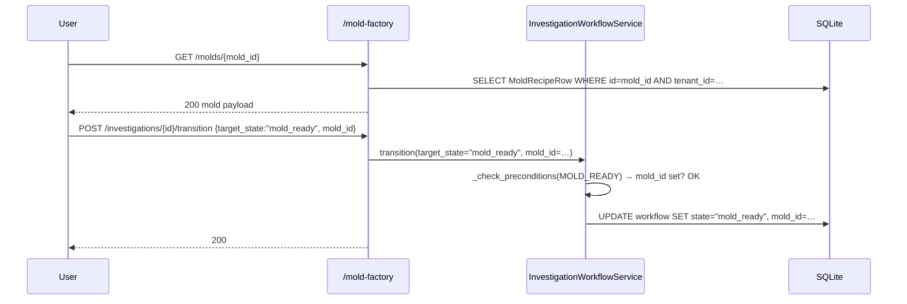

### 3.6 `acquiring` — Owner Stage: Real Evidence Acquisition

**Backend.** `foundry/service.py ::
FoundryService.sandbox_test_candidate` — same method as in
`building_capabilities`, but here the intent is to retrieve evidence
for the *investigation*. OpenAlex path: `search_works(query, per_page)`
→ 429 fallback to `get_work("W2741809807")`. Returns
`SandboxTestResult` with `sample_works[]` (max 3 items:
`openalex_id`, `doi`, `title`, `publication_year`, `cited_by_count`,
`is_oa`).

**API.** `POST /foundry/candidates/{id}/sandbox-test` (same endpoint,
different intent). No dedicated "acquire for investigation" endpoint
yet — the caller passes the result to `MemoryCurator.ingest_evidence`.

**UI display.** "Data Acquisition" panel: mold's
`composition.capability_ids[]` as a checklist. For each: "Fetch from
{source}" button. Live log: `Calling https://api.openalex.org/works?search=…`
→ spinner → `Received N works in X ms` (or `Rate-limited; falling back
to single-work GET`). Sample results stream as cards (title, year,
cited_by_count, OA badge, openalex_id link). Each card has "Send to
Memory" button → advances workflow to `normalizing`.

**Valid actions.** Trigger acquisition per capability; inspect sample
works; skip a capability (records a gap); advance to `normalizing`
once ≥ 1 evidence item is sent.

**Failure modes.**
* Network / timeout / 5xx → `SandboxTestResult.error` set,
  `success=false`. UI: retry.
* HTTP 429 → connector auto-falls-back; if fallback also fails →
  `error="rate_limited_after_retries"`. UI: *"OpenAlex rate limit
  reached. Retry after midnight UTC or set MANARA_OPENALEX_API_KEY."*
* Content-type mismatch → `SsrfViolation(rule="unexpected_content_type")`.
  UI: *"Source returned an unexpected content type. Connector
  quarantined for review."*
* `row.mold_id is None` → `blocker="cannot acquire: no mold_id set"`.

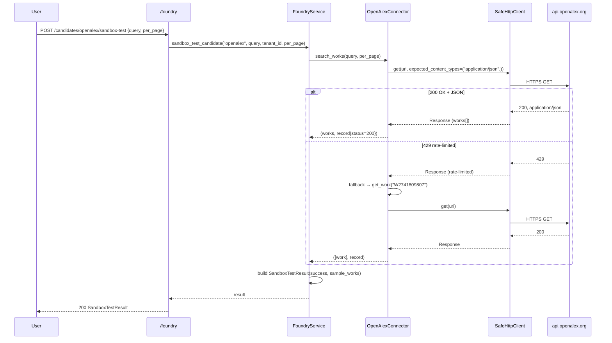

### 3.7 `normalizing` — Owner Stage: Memory (ingest)

**Backend.** `memory/curator.py :: MemoryCurator.ingest_evidence`.
Steps: (1) compute SHA-256 checksum (or reuse); (2) canonicalize URL
and DOI (lowercase scheme+host, strip trailing slash, sort query
params; strip `https://doi.org/` prefix); (3) dedup check on
`(tenant_id, content_checksum)` — if duplicate, log
`evidence_deduplicated`, return existing ID, no re-store; if from a
different investigation, also record `InvestigationReuseRow`; (4)
bitemporal safety: `observed_at ≤ ingested_at` (raises `ValueError`
otherwise); (5) store raw content in object store; (6) insert
`EvidenceItemRow`; (7) log `evidence_ingested` decision.

**API.**
* `POST /memory/evidence` — body: `{evidence: EvidenceContract,
  investigation_id, raw_content_b64?, actor}`. Returns
  `IngestEvidenceResponse{evidence_id, deduplicated,
  reused_from_investigation_id?, stored_at_ref?, checksum, decision_id}`.
* `GET /memory/evidence/{id}` — fetch one.
* `GET /memory/investigations/{id}/evidence` — list.

**UI display.** "Memory" panel: evidence items as a list — `id`,
`source_id`, `kind` (QUOTE/DATASET/METRIC/IMAGE/etc.),
`content_preview` (~120 chars), freshness chip (`fresh` ≤ 7d,
`stale` ≤ 90d, `outdated` > 90d). "deduplicated" badge if a prior copy
exists. "reused from inv-X" badge if from another investigation in
the same tenant. "Contradictions" sub-panel: lists claims with
`verdict=contested` (visually distinguish supporting vs refuting
edges — the spec forbids silently resolving contradictions).

**Valid actions.** Ingest additional evidence; inspect each item's
full payload; promote a claim's verdict; advance to `evidencing`.

**Failure modes.**
* Bitemporal violation → `ValueError` → 422. UI: *"Cannot ingest
  evidence observed in the future."*
* Tenant mismatch → `ValidationError` → 422. UI: *"Evidence tenant
  does not match the investigation's tenant."*
* DB write conflict (duplicate ID) → `ValueError` → 422.

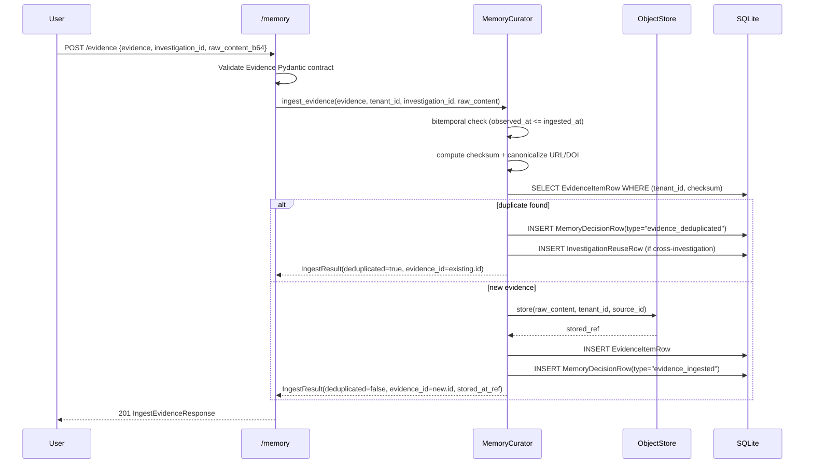

### 3.8 `evidencing` — Owner Stages: Memory (claims) + Analysis

**Backend.** Still `MemoryCurator`, now operating on claims + edges:

* `attach_claim(claim_id, tenant_id, investigation_id, evidence_id,
  statement, verdict="candidate", independence_group?)` — inserts a
  `ClaimRow` linked to an `EvidenceItemRow`. Initial verdict is
  `candidate`.
* `add_support_edge(tenant_id, claim_id, evidence_id, relation ∈
  {supports, refutes, qualifies}, weight, notes)` — inserts a
  `ClaimSupportEdgeRow`. If `relation="refutes"` and claim verdict is
  `candidate` or `supported`, the curator **does not** silently
  overwrite — it demotes verdict to `contested` and logs a
  `claim_contradicted` decision with the previous verdict recorded.
* `promote_claim(claim_id, tenant_id, new_verdict, rationale, actor)`
  — moves verdict along `candidate → supported → contested →
  refuted → superseded`. Each promotion appends a `claim_promoted`
  decision; previous verdict preserved in `payload.previous_verdict`.

**API.**
* `POST /memory/evidence/{id}/claims` — attach a claim.
* `POST /memory/claims/{id}/support` — add supports/refutes/qualifies edge.
* `PATCH /memory/claims/{id}/verdict` — promote verdict.
* `GET /memory/investigations/{id}/claims` — list claims.
* `POST /memory/investigations/{id}/search-prior` — search prior memory.
* `POST /memory/investigations/{id}/reuse` — record a reuse link.
* `GET /memory/investigations/{id}/decisions` — full audit log.
* `POST /memory/snapshots` — capture a source snapshot.
* `GET /memory/investigations/{id}/at-cutoff` — bitemporal replay
  (only evidence whose `ingested_at ≤ cutoff`).

**UI display.** "Claims" panel — each claim: statement, verdict chip
(`candidate`=grey, `supported`=green, `contested`=amber,
`refuted`=red, `superseded`=blue/strikethrough), `evidence_id` link.
For each claim: "Supports / Refutes / Qualifies" toggle (opens a modal
to attach an edge to another evidence item). "Promote Verdict" button
(modal requires `rationale` ≥ 10 chars and `actor`). "Contradictions"
sub-panel: every `contested` claim, both supporting and refuting
evidence IDs side-by-side (never collapsed). "Search Prior Memory"
search box.

**Valid actions.** Attach claims; add support/refute/qualify edges;
promote verdicts (mandatory rationale); search prior memory; record
reuse; advance to `forecasting_or_scenarios` (optional) or directly
to `drafting`.

**Failure modes.** Promoting to same verdict → `ValueError("claim
already in verdict=X")` → 422. Attaching a claim to evidence owned by
another tenant → `ValueError("evidence {id} not found for tenant
{tenant}")` → 422. Bitemporal cutoff replay returns evidence the user
did not expect → response includes both `reusable_evidence[]` and
`gaps[]`; UI must show `gaps[]` if non-empty.

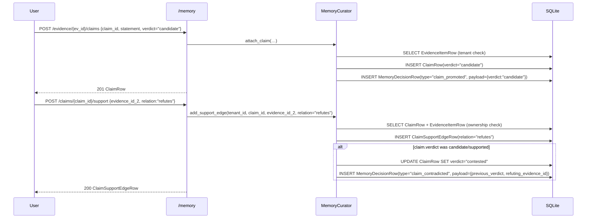

### 3.9 Specialist Execution (optional, parallel to `evidencing`)

**Owner stage.** "Specialist Execution when appropriate". **Not a
state-machine transition** — runs as a side-path *during* `evidencing`.

**Backend.**
* `agents/factory.py :: GeneralistVsSpecialistResolver.resolve()` —
  decides generalist vs specialist based on task keywords
  ("evaluate", "clinical", "regulatory", "diagnose", …) and required
  evidence types (`clinical_trial`, `regulatory_filing`,
  `patent_family`).
* `agents/factory.py :: AgentRecipeRegistry.save_recipe() / get_recipe() /
  rehydrate()` — the "phone book" of specialist recipes.
* `agents/factory.py :: ToolPermissionResolver.resolve()` — computes
  `recipe ∩ capability − denied` (intersection, NEVER union). Per
  owner (G05): the agent CANNOT grant itself extra tools.
* `agents/factory.py :: EphemeralAgentRuntime.instantiate() / execute()
  / terminate() / evaluate()` — runs the agent.
* `agents/tool_executor.py :: RegistryToolExecutor.invoke()` —
  dispatches `TOOL_CALL:` lines emitted by the LLM to real MANARA
  services (`registry.search`, `memory.search_prior`,
  `foundry.search_openalex`). Enforces the granted set — any tool
  not in `granted_tools` is recorded as
  `status="denied_not_in_granted_set"`. (Fix F5 in
  BACKEND-VERIFICATION-01; previously tools were recorded but never
  enforced.)

**API.**
* `POST /agents/resolve` — `{task_description, required_evidence_types?}`.
* `GET  /agents/recipes` — list recipes.
* `POST /agents/recipes/seed-clinical` — seed Clinical Prosthetics Reviewer.
* `POST /agents/recipes/seed-generalist` — seed General Analyst.
* `POST /agents/sessions` — instantiate an ephemeral session.
* `POST /agents/sessions/{id}/execute` — call LLM + dispatch tools.
* `POST /agents/sessions/{id}/terminate` — set status=terminated.
* `POST /agents/sessions/{id}/evaluate` — record evaluation.
* `GET  /agents/sessions/{id}` — fetch session details.

**UI display.** Collapsible "Specialists" side-panel (visible only if
`resolve()` returned `needs_specialist=true`). For each session:
`recipe_id`, `display_name`, `state`, `granted_tools[]`,
`denied_tools[]`. Live execution log: each `ToolInvocation` rendered
with `tool_name`, `status` (executed / denied_not_in_granted_set /
not_implemented / error), and `result`/`error`. "Evaluate" button
(modal: outcome, quality_score, improvement_over_generalist,
criteria_results). For the MockProvider (only provider in
BACKEND-VERIFICATION-01): a "MOCK" badge must be shown — owner
explicitly forbids claiming a live LLM ran when only the MockProvider
did.

**Valid actions.** Resolve; instantiate; execute; inspect tool
invocations; terminate; evaluate (promotes recipe from `on_demand`
to `recipe_saved` if `quality_score >= 0.6`).

**Failure modes.** Recipe not found for tenant → `ValueError("recipe
{id} not found for tenant {tenant}")` → 422. Tool not in granted set
→ recorded as `denied_not_in_granted_set`; agent loop continues. LLM
provider failure → `session.status="failed"`, `session.error=str(exc)`;
session row remains for audit (owner: failed agents must record their
error, not silently swallow).

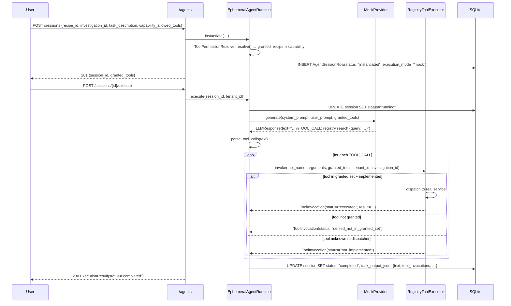

### 3.10 `forecasting_or_scenarios` — Owner Stage: Foresight (optional)

**Entry.** `evidencing → forecasting_or_scenarios` (optional — the
investigation may also go directly to `drafting`).

**Backend.**
* `foresight/engine.py :: ForecastPolicyService.assess_evidence(data_points,
  cutoff_date, has_contradictions)` — decision tree:
  1. `< 2 data points before cutoff` → `insufficient_evidence`.
  2. `< MIN_DATA_POINTS (5) before cutoff` → `insufficient_evidence`.
  3. Seasonal pattern → `naive_seasonal`.
  4. Trend detected → `trend_ets`.
  5. Otherwise → `naive_seasonal` (simplest baseline).
  NEVER fabricates probabilities — if evidence is insufficient, it
  says so explicitly. Per owner (G06): *"لا تُنشئ توقعات رقمية لمجرد
  أن المستخدم طلب أرقاماً."*
* `BaselineForecaster.naive_forecast()` / `seasonal_naive_forecast()`.
* `BacktestEngine.run_backtest()` — historical replay with strict
  bitemporal leakage prevention. Splits data points by `published_at`
  (not `observed_at`) — a study published in September about an event
  in June is NOT available at a July cutoff.
* `ForecastRegistry.create_draft() / publish() / revise() /
  try_modify()` — immutable publication: once `status="published"`,
  cannot be modified; revisions create a new row with
  `subsequent_revision_of=original_id`.

**API.**
* `POST /foresight/assess` — recommend a method.
* `POST /foresight/forecasts` — create a draft forecast.
* `POST /foresight/forecasts/{id}/publish` — immutable publish.
* `POST /foresight/forecasts/{id}/revise` — create a revision.
* `POST /foresight/forecasts/{id}/try-modify` — test immutability.
* `POST /foresight/backtest` — run a backtest with leakage check.
* `GET  /foresight/forecasts/{id}` — fetch a forecast.

**UI display.** "Foresight" panel (shown only if user opted in;
otherwise "Skip Foresight" button → `drafting` directly). If opted in:
render `EvidenceAssessment` — `recommended_method` chip
(`insufficient_evidence`=red, `naive_seasonal`=blue, `trend_ets`=green),
`sufficient_for_quantitative` boolean, `assessment_reasoning` text. If
`recommended_method="insufficient_evidence"`: clear message *"Evidence
is insufficient for a quantitative forecast. A scenario-based
assessment will be produced instead."* — user CANNOT override (owner
forbids manufacturing probabilities). If quantitative: forecast form
(`target`, `metric`, `unit`, `horizon_end`, `reference_region`,
`method`, `cutoff_date`, `point_estimate`, `assumptions[]`). After
publish: immutable forecast ID with 🔒 icon. "Run Backtest" button.

**Valid actions.** Assess evidence (deterministic); create draft
(only if method is quantitative); publish (immutable); create
revision; run backtest; skip foresight → advance to `drafting`.

**Failure modes.** `try_modify` on a published forecast → registry
returns `{"modified": false, "reason": "published forecasts are
immutable"}`. UI: *"This forecast is locked. Create a revision
instead."* Backtest detects leaked evidence (`leakage_detected=true`)
→ forecast rejected. UI: *"Bitemporal leakage detected: evidence {id}
was published after cutoff. Forecast rejected."*

```mermaid
sequenceDiagram
    participant U as User
    participant API as /foresight
    participant FPS as ForecastPolicyService
    participant FR as ForecastRegistry
    participant BE as BacktestEngine
    participant DB as SQLite
    U->>API: POST /assess {data_points, cutoff_date, has_contradictions}
    API->>FPS: assess_evidence(…)
    FPS->>FPS: split by published_at; check len(before_cutoff) >= 5
    alt < 5 points
        FPS-->>API: EvidenceAssessment(recommended_method="insufficient_evidence")
    else sufficient + seasonal
        FPS-->>API: EvidenceAssessment(recommended_method="naive_seasonal")
    end
    API-->>U: 200
    alt sufficient_for_quantitative
        U->>API: POST /forecasts {target, metric, unit, horizon_end, method, cutoff_date, point_estimate}
        API->>FR: create_draft(…)
        FR->>DB: INSERT ForecastRow(status="draft", leakage_check_passed=true)
        API-->>U: 201 {forecast_id}
        U->>API: POST /forecasts/{id}/publish
        API->>FR: publish(…)
        FR->>DB: UPDATE forecast SET status="published"
        API-->>U: 200
        U->>API: POST /backtest {forecast_id, data_points, cutoff_date, horizon_days}
        API->>BE: run_backtest(…)
        BE->>BE: check_evidence_leakage(evidence_ids, cutoff_date)
        BE->>DB: INSERT BacktestResultRow(leakage_detected=false, mae, rmse, …)
        API-->>U: 200 BacktestResult
    else insufficient_evidence
        Note over U: UI: "Evidence insufficient. No forecast produced."<br/>User can still advance to drafting (scenario-based report).
    end
```

### 3.11 `drafting` — Owner Stage: Publishing (compose)

**Backend.**
* `publishing/engine.py :: DossierBuilder.build(investigation_id,
  tenant_id, title, scope)` — loads all `EvidenceItemRow`,
  `ClaimRow`, `ForecastRow` for the investigation; builds
  `DossierSection[]` (Scope, Executive Summary, Findings,
  Contradictions, Forecasts); returns `DossierOutput`. Deliverable
  type decided here: `has_evidence=true` → `research_deliverable`;
  `has_evidence=false` → `coverage_blocker_report` (owner forbids
  passing off a blocker as a completed research deliverable).
* `PresenterEditionBuilder.build(dossier)` — derives a 3-5 minute
  script. `estimated_duration_minutes` = `word_count / 140`
  (WORDS_PER_MINUTE), not guessed.
* `StoryboardBuilder.build(dossier)` — derives a visual storyboard
  with scenes classified by `scene_type`. Fictional / scenario scenes
  MUST carry `disclosure_text`; QualityGate rejects them otherwise.

**API.** `POST /publishing/publications` — body: `{investigation_id,
output_type ∈ {research_dossier, presenter_edition,
visual_storyboard}, title, scope}`. Returns `{publication_id,
output_type, status, quality_gate_passed, quality_gate_issues[],
deliverable_type, downloadable}`.

**UI display.** "Output Type" selector (Research Dossier / Presenter
Edition / Visual Storyboard). "Title" input (5-500 chars). "Scope"
JSON editor. "Compose & Run Quality Gate" button. After composition:
render the dossier / script / storyboard preview.

**Valid actions.** Choose output type; edit title and scope; compose;
inspect `quality_gate_issues[]`; if `quality_gate_passed=false`: edit
claims/scenes and re-compose; if `true`: advance to `verification`.

**Failure modes.** `output_type` not in literal enum → 422. Title
outside 5-500 chars → 422. Composition crash →
`ValidationError("dossier composition failed: …")` 422.

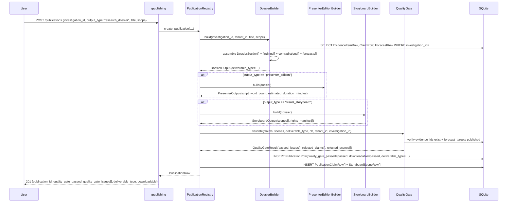

### 3.12 `verification` — Owner Stage: Publishing (gate)

**Backend.** The QualityGate already ran during `drafting` (invoked
inside `PublicationRegistry.create_publication`). The `verification`
state is the *formal* workflow acknowledgment that the gate passed.
No new service; the workflow service records the transition with
`actor` and `rationale` for audit.

The QualityGate enforces 6 rejection rules (G07-R1):
1. `fact` claim without verified evidence IDs → rejected. Evidence IDs
   verified against actual G03 memory (not just non-empty strings).
2. `data_visualization` / `evidence_backed_factual` scene without
   evidence source → rejected.
3. `fictional_scene` / `scenario_illustration` without disclosure
   text → rejected.
4. Uncalibrated `forecast` claim mentioning probability → rejected;
   must reference a published forecast target from G06.
5. Third-party scene (source ≠ MANARA) with `rights_status` in
   `("unknown", "restricted")` → rejected.
6. `coverage_blocker_report` claim saying "complete" → rejected
   (blocker reports must not masquerade as research deliverables).

**API.** No dedicated verification endpoint (verification is implicit
in `quality_gate_passed`). `GET /publishing/publications/{id}` —
inspect gate result.

**UI display.** "Quality Gate" panel: `quality_gate_passed` chip
(green ✓ / red ✗), `quality_gate_issues[]` list, `rejected_claims[]`
and `rejected_scenes[]` lists. "Fix Issues" button (returns to
`drafting`). "Confirm Verified" button → advances to
`deliverable_ready` (enabled only if `quality_gate_passed=true`).

**Valid actions.** Inspect gate result; fix issues (return to
drafting); confirm verification.

**Failure modes.** Workflow pre-condition: `quality_gate_passed=false`
but caller tries to advance to `deliverable_ready` → the workflow
service still allows the transition (gate verdict is on the
publication, not the workflow), BUT the publication will be
non-downloadable. The UI MUST check `downloadable=true` before
showing the Download button.

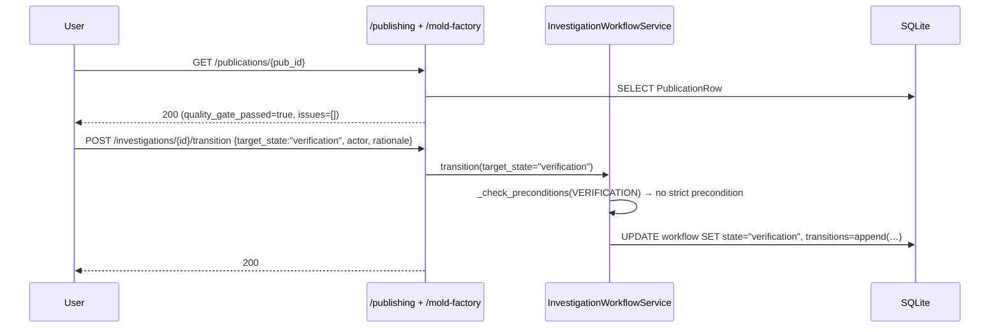

### 3.13 `deliverable_ready` — Owner Stage: Download

**Backend.** `publishing/engine.py :: PublicationRegistry.download(pub_id,
tenant_id, format_)`. Returns content as:
* JSON (default) — `dict[str, Any]` serialized to UTF-8.
* Markdown — `_to_markdown(row)`.
* Text — `_to_text(row)`.

The route wraps the response as a real HTTP file download with
`Content-Disposition: attachment; filename="..."` and the correct
`Content-Type`. Per owner (G07-R1): *"اجعل API التنزيل يعيد ملفات
فعلية بصيغ JSON و Markdown و TXT، مع Content-Type واسم ملف صحيحين."*
If not downloadable (gate failed), service returns `None` → route
raises `NotFoundError`.

**API.**
* `GET /publishing/publications` — list (tenant-scoped).
* `GET /publishing/publications/{id}` — fetch one.
* `GET /publishing/publications/{id}/download?format=json|markdown|text`
  — file download.

**UI display.** "Deliverable Ready" panel: `publication_id`,
`output_type`, `title`, `quality_gate_passed`, `downloadable`. Three
download buttons: "Download JSON", "Download Markdown", "Download
Text" (DISABLED if `downloadable=false`). "Preview" tab. "Coverage
Blocker" badge if `deliverable_type="coverage_blocker_report"`.
"Archive Investigation" button → advances to `archived`.

**Valid actions.** Download in any format; preview; inspect audit
log (`/memory/investigations/{id}/decisions`); archive.

**Failure modes.** `format` not in `(json, markdown, text)` → 422.
Publication not found or wrong tenant → 404. `downloadable=false` →
404 with message *"publication {id} not found or not downloadable
(quality gate may have failed)"*. UI: *"This publication is not
downloadable because the quality gate failed. Fix the issues and
re-compose."* Empty content (should never happen — tests in
`test_publishing.py` enforce non-empty content + Arabic-safe UTF-8).

```mermaid
sequenceDiagram
    participant U as User
    participant API as /publishing
    participant PR as PublicationRegistry
    participant DB as SQLite
    U->>API: POST /investigations/{id}/transition {target_state:"deliverable_ready"}
    API->>API: (workflow service call)
    API-->>U: 200
    U->>API: GET /publications/{pub_id}/download?format=markdown
    API->>PR: download(pub_id, tenant_id, format_="markdown")
    PR->>DB: SELECT PublicationRow WHERE id=pub_id AND tenant_id=…
    alt row.downloadable == true
        PR->>PR: _to_markdown(row)
        PR-->>API: markdown_str
        API-->>U: 200 text/markdown + Content-Disposition: attachment; filename="…"
    else row.downloadable == false
        PR-->>API: None
        API-->>U: 404 NotFoundError
    end
```

### 3.14 `archived` — Terminal

**Entry.** `deliverable_ready → archived` (terminal). No
pre-conditions (per spec, any state can transition to archived;
archived is terminal). The contract auto-sets `archived_at = updated_at`
when `state == archived`, and rejects setting `archived_at` elsewhere.

**API.** `POST /mold-factory/investigations/{id}/transition
{target_state:"archived"}`; `GET /mold-factory/investigations/{id}/workflow`.

**UI display.** "Archived" badge. Read-only view of the entire
investigation (question, scope, mold, evidence, claims, publications,
decisions audit log). "Reopen as New Investigation" button (creates a
new investigation with the same scope but a new ID — the old one
stays archived forever; the spec forbids un-archiving).

**Valid actions.** View (read-only); reopen as new; export audit
trail as JSON.

**Failure modes.** Attempting to transition OUT of `archived` →
transitions table has `ARCHIVED: set()`, so `TransitionResult(transitioned=False,
blocker="illegal transition archived → …. Allowed: []")`. UI: *"This
investigation is archived and cannot be reactivated. Create a new
investigation instead."*

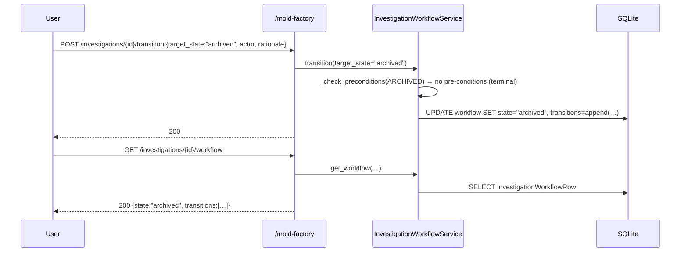

---

## 4. Complete State Reference Table

| # | State                          | Owner stage                       | Owner / Actor                | Evidence required                                          | Allowed forward transitions                | Failure modes                                                                                                                                |
|---|--------------------------------|-----------------------------------|-------------------------------|------------------------------------------------------------|--------------------------------------------|----------------------------------------------------------------------------------------------------------------------------------------------|
| 1 | `received`                     | Question                          | system (auto via Architect)  | None (topic only)                                          | `scoped`                                   | Topic < 10 chars → 422; DB write failure → 422.                                                                                              |
| 2 | `scoped`                       | Investigation                     | user                          | Non-empty topic                                            | `coverage_checked`                         | Empty topic → `blocker="cannot scope: investigation has no topic"`.                                                                          |
| 3 | `coverage_checked`             | Needs Analysis + Op. Source Sel.  | system (MoldArchitect)        | MoldArchitect ran (mold_id or gap analyses exist)          | `building_capabilities`, `mold_ready`     | Decomposer returned 0 needs → `ValidationError`; CATALOG-only needs recorded as `operational_gap` (not a failure — recorded honestly).     |
| 4 | `building_capabilities`        | Mold (detour)                     | user (Owner approval action) | At least one sandbox test passed for each catalog-only cap. | `mold_ready`                               | Sandbox test failure → not promoted; Approval without sandbox → `ValueError("approval requires sandbox_tested…")`; SSRF violation → `SsrfViolation`. |
| 5 | `mold_ready`                   | Mold (final)                      | user                          | `mold_id` set on workflow row                              | `acquiring`                                | No mold_id → `blocker="cannot enter mold_ready: no mold_id set"`.                                                                            |
| 6 | `acquiring`                    | Real Evidence Acquisition         | user                          | `mold_id` set                                              | `normalizing`                              | No mold_id → `blocker="cannot acquire: no mold_id set"`; Network/429/SSRF on Foundry call → `SandboxTestResult.error` set.                  |
| 7 | `normalizing`                  | Memory (ingest)                   | system (MemoryCurator)        | ≥ 1 evidence item ingested OR ≥ 1 gap analysis              | `evidencing`                               | Bitemporal violation → `ValueError`; Tenant mismatch → `ValueError`; Duplicate checksum → deduped (not a failure).                          |
| 8 | `evidencing`                   | Memory (claims) + Analysis        | user                          | ≥ 1 evidence item OR ≥ 1 gap analysis                      | `forecasting_or_scenarios`, `drafting`     | Attach claim to wrong-tenant evidence → `ValueError`; Promote to same verdict → `ValueError`.                                              |
| 9 | `forecasting_or_scenarios`     | Foresight (optional)              | user                          | ≥ `MIN_DATA_POINTS` (5) before cutoff for quantitative     | `drafting`                                 | `< 5` data points → `recommended_method="insufficient_evidence"` (not a failure — engine refuses to fabricate, per owner).                |
| 10| `drafting`                     | Publishing (compose)              | user                          | Output type chosen + title ≥ 5 chars                       | `verification`                             | Invalid `output_type` → 422; Title < 5 chars → 422; Composition crash → `ValidationError("dossier composition failed: …")`.                |
| 11| `verification`                 | Publishing (gate)                 | system (QualityGate)          | `quality_gate_passed=true` for downloadable                | `deliverable_ready`                        | Quality gate failed → `quality_gate_passed=false`, `downloadable=false`. UI must disable Download button.                                  |
| 12| `deliverable_ready`            | Download                          | user                          | `downloadable=true` publication                            | `archived`                                 | Download on non-downloadable → `NotFoundError` 404; Empty content → forbidden (tests enforce non-empty + Arabic-safe).                     |
| 13| `archived`                     | (terminal)                        | user                          | —                                                          | (none — terminal)                          | Any forward transition attempt → `blocker="illegal transition archived → …"`.                                                                |

---

## 5. End-to-End Happy-Path Sequence (Question → Download)

```mermaid
sequenceDiagram
    autonumber
    participant U as User
    participant API as FastAPI
    participant SVC as Backend Services
    participant DB as SQLite
    Note over U,DB: 1. received — POST /mold-factory/compose {query}
    U->>API: POST /compose {query}
    API->>SVC: MoldArchitect.compose_mold → INSERT InvestigationRow(state="received") + MoldRecipeRow
    API-->>U: 201 {investigation_id, mold_recipe_id, is_complete:true}
    Note over U,DB: 2. received → scoped — POST /investigations/{id}/transition
    U->>API: POST /investigations/{id}/transition {target_state:"scoped"}
    API->>SVC: InvestigationWorkflowService.transition → UPDATE workflow SET state="scoped"
    API-->>U: 200
    Note over U,DB: 3. scoped → coverage_checked (mold_id already set by MoldArchitect)
    U->>API: POST /investigations/{id}/transition {target_state:"coverage_checked", mold_id=…}
    API-->>U: 200
    Note over U,DB: 4. coverage_checked → mold_ready (is_complete=true → skip building_capabilities)
    U->>API: POST /investigations/{id}/transition {target_state:"mold_ready"}
    API-->>U: 200
    Note over U,DB: 5. mold_ready → acquiring — POST /foundry/candidates/openalex/sandbox-test
    U->>API: POST /foundry/candidates/openalex/sandbox-test {query, per_page}
    API->>SVC: FoundryService.sandbox_test_candidate → real HTTPS call to api.openalex.org
    API-->>U: 200 SandboxTestResult{success:true, sample_works:[…]}
    U->>API: POST /investigations/{id}/transition {target_state:"acquiring"}
    API-->>U: 200
    Note over U,DB: 6. acquiring → normalizing — POST /memory/evidence
    U->>API: POST /memory/evidence {evidence, investigation_id, raw_content_b64}
    API->>SVC: MemoryCurator.ingest_evidence → INSERT EvidenceItemRow + MemoryDecisionRow(type="evidence_ingested")
    API-->>U: 201 IngestEvidenceResponse
    U->>API: POST /investigations/{id}/transition {target_state:"normalizing"}
    API-->>U: 200
    Note over U,DB: 7. normalizing → evidencing — POST /memory/evidence/{id}/claims
    U->>API: POST /memory/evidence/{ev_id}/claims {claim_id, statement, verdict:"candidate"}
    API->>SVC: MemoryCurator.attach_claim → INSERT ClaimRow + MemoryDecisionRow(type="claim_promoted")
    API-->>U: 201
    U->>API: POST /investigations/{id}/transition {target_state:"evidencing"}
    API-->>U: 200
    Note over U,DB: 8. Specialist Execution (parallel; no state change) — POST /agents/sessions/.../execute
    U->>API: POST /agents/sessions {recipe_id, investigation_id, task_description, capability_allowed_tools}
    API->>SVC: EphemeralAgentRuntime.instantiate → INSERT AgentSessionRow(status="instantiated", execution_mode="mock")
    API-->>U: 201 {session_id, granted_tools}
    U->>API: POST /agents/sessions/{id}/execute
    API->>SVC: EphemeralAgentRuntime.execute → MockProvider.generate → parse TOOL_CALL → RegistryToolExecutor.invoke
    API-->>U: 200 ExecutionResult(status="completed", tool_invocations=[…])
    Note over U,DB: 9. evidencing → forecasting_or_scenarios (optional)
    U->>API: POST /foresight/assess {data_points, cutoff_date}
    API->>SVC: ForecastPolicyService.assess_evidence → EvidenceAssessment(recommended_method:"naive_seasonal")
    API-->>U: 200
    U->>API: POST /foresight/forecasts {target, method, …}
    API-->>U: 201 {forecast_id}
    U->>API: POST /foresight/forecasts/{id}/publish
    API-->>U: 200 {status:"published"}
    U->>API: POST /investigations/{id}/transition {target_state:"forecasting_or_scenarios"}
    API-->>U: 200
    Note over U,DB: 10. forecasting_or_scenarios → drafting — POST /publishing/publications
    U->>API: POST /publishing/publications {investigation_id, output_type:"research_dossier", title, scope}
    API->>SVC: PublicationRegistry.create_publication → DossierBuilder.build → QualityGate.validate(passed=true)
    API->>SVC: INSERT PublicationRow(quality_gate_passed=true, downloadable=true, deliverable_type="research_deliverable")
    API-->>U: 201 {publication_id, quality_gate_passed:true, downloadable:true}
    U->>API: POST /investigations/{id}/transition {target_state:"drafting"}
    API-->>U: 200
    Note over U,DB: 11. drafting → verification
    U->>API: POST /investigations/{id}/transition {target_state:"verification"}
    API-->>U: 200
    Note over U,DB: 12. verification → deliverable_ready
    U->>API: POST /investigations/{id}/transition {target_state:"deliverable_ready"}
    API-->>U: 200
    Note over U,DB: 13. Download
    U->>API: GET /publishing/publications/{id}/download?format=markdown
    API->>SVC: PublicationRegistry.download → _to_markdown(row)
    API-->>U: 200 text/markdown + Content-Disposition: attachment; filename="…"
    Note over U,DB: 14. deliverable_ready → archived
    U->>API: POST /investigations/{id}/transition {target_state:"archived"}
    API-->>U: 200
```

---

## 6. Coverage-Blocker Path (insufficient evidence)

The owner explicitly required: *"إصدار Coverage Blocker Report عندما
يتعذر استكمال التحقيق."* When evidence is insufficient, the engine
must NOT fabricate a research deliverable. Instead it produces a
`coverage_blocker_report` documenting the gaps.

The blocker path branches at three points:

1. **At `coverage_checked`** — if `MoldArchitect.compose_mold` returns
   `is_complete=false` (some needs have only CATALOG coverage), the
   workflow goes to `building_capabilities`. If the user gives up on
   finding connectors, they can still advance (workflow allows
   `coverage_checked → mold_ready` if a mold_id is set, even with
   gaps). The resulting `deliverable_type` will be
   `coverage_blocker_report`.
2. **At `evidencing`** — if zero evidence was ingested, the
   pre-condition for `evidencing` requires *either* evidence OR a gap
   analysis. If the user provided neither: `blocker="cannot enter
   evidencing: no evidence collected AND no gap analysis recorded"`.
3. **At `deliverable_ready`** — if zero evidence AND zero gap
   analyses: transition fails. If gaps exist but no evidence:
   transition succeeds but the publication's `deliverable_type` will
   be `coverage_blocker_report`.

The Quality Gate enforces Rule 6: a `coverage_blocker_report` claim
that contains the word "complete" is rejected. This prevents the
blocker report from masquerading as a completed research deliverable.

```mermaid
sequenceDiagram
    autonumber
    participant U as User
    participant API as FastAPI
    participant MA as MoldArchitect
    participant P as PublicationRegistry
    participant QG as QualityGate
    participant W as InvestigationWorkflowService
    participant DB as SQLite
    Note over U,DB: Step 1 — Question → coverage_checked (with gaps)
    U->>API: POST /mold-factory/compose {query}
    API->>MA: compose_mold(…)
    MA->>MA: decompose → some needs have CATALOG only
    MA->>DB: INSERT GapAnalysisRow(status="operational_gap") for each
    MA-->>API: MoldCompositionResult(is_complete=false, deliverable_type="coverage_blocker_report", gaps=[…])
    API-->>U: 201
    Note over U,DB: Step 2 — User decides not to wait for connectors; advances with the gap-laden mold.
    U->>API: POST /investigations/{id}/transition {target_state:"mold_ready", mold_id=…}
    API->>W: transition(target_state="mold_ready", mold_id=…)
    W->>DB: UPDATE workflow SET state="mold_ready"
    API-->>U: 200
    Note over U,DB: Step 3 — User skips acquisition (no evidence to fetch)
    U->>API: POST /investigations/{id}/transition {target_state:"acquiring"}
    API->>W: transition(target_state="acquiring")
    W->>DB: UPDATE workflow SET state="acquiring"
    API-->>U: 200
    Note over U,DB: Step 4 — acquiring → normalizing (no evidence actually ingested)
    U->>API: POST /investigations/{id}/transition {target_state:"normalizing"}
    API->>W: transition(target_state="normalizing")
    W->>DB: UPDATE workflow SET state="normalizing"
    API-->>U: 200
    Note over U,DB: Step 5 — Try evidencing: gap_count>0 → ALLOWED (per G04-R1)
    U->>API: POST /investigations/{id}/transition {target_state:"evidencing"}
    API->>W: transition(target_state="evidencing")
    W->>W: _check_preconditions(EVIDENCING): ev_count=0 BUT gap_count>0 → ALLOWED
    W->>DB: UPDATE workflow SET state="evidencing"
    API-->>U: 200
    Note over U,DB: Step 6 — Skip foresight → drafting
    U->>API: POST /publishing/publications {investigation_id, output_type:"research_dossier", title, scope}
    API->>P: create_publication(…)
    P->>P: DossierBuilder.build → ev_rows=[] → has_evidence=false → deliverable_type="coverage_blocker_report"
    P->>QG: validate(claims=[], deliverable_type="coverage_blocker_report", …)
    QG-->>P: QualityGateResult(passed=true, issues=[]) (no claims to reject)
    P->>DB: INSERT PublicationRow(quality_gate_passed=true, downloadable=true, deliverable_type="coverage_blocker_report")
    API-->>U: 201 {publication_id, deliverable_type:"coverage_blocker_report", downloadable:true}
    Note over U,DB: Step 7 — User downloads the blocker report
    U->>API: GET /publishing/publications/{id}/download?format=json
    API-->>U: 200 application/json + Content-Disposition: attachment
    Note over U: UI MUST clearly label this as a Coverage Blocker Report — NOT a research deliverable.<br/>The "Coverage Blocker" badge must be shown next to the title.
```

---

## 7. Acceptance Test Mapping

The 10-step acceptance test in
`backend/tests/test_investigation_lifecycle.py` exercises every stage
of the canonical happy path plus the blocker path. The table below
maps each test step to the stage documentation above.

| Step | Test method                                                              | Stage documented in §3.x         | Key assertion                                                                                                          |
|------|--------------------------------------------------------------------------|----------------------------------|------------------------------------------------------------------------------------------------------------------------|
| 1    | `test_step_1_question_creates_investigation`                             | §3.1 `received`                  | `InvestigationRow` exists with stable ID, `state="received"`, `topic` matches the question.                             |
| 2    | `test_step_2_mold_composition_detects_needs`                              | §3.3 `coverage_checked`          | `MoldArchitect.compose_mold` returns `investigation_id` matching step 1, `detected_needs ≥ 1`, `coverage ≥ 1`.        |
| 3    | `test_step_3_evidence_ingestion_with_investigation_id`                   | §3.7 `normalizing`               | 3 evidence items ingested, all linked to the SAME `investigation_id`, none `reused_from_investigation_id`.            |
| 4    | `test_step_4_contradicting_evidence_is_preserved`                        | §3.7 + §3.8 (memory invariants)  | Two contradicting evidence items BOTH still exist after ingest — never silently merged/deleted.                        |
| 5    | `test_step_5_memory_reuse_for_new_investigation`                          | §3.8 (search prior memory)       | Investigation B's `search_prior_memory` finds evidence ingested by Investigation A in the same tenant.                  |
| 6    | `test_step_6_agent_executes_with_tool_invocations`                        | §3.9 Specialist Execution        | `EphemeralAgentRuntime.execute()` returns `status="completed"`; `task_output_json["tool_invocations"]` is non-empty.  |
| 7    | `test_step_7_foresight_refuses_insufficient_evidence`                     | §3.10 `forecasting_or_scenarios` | With `< 5` data points, `recommended_method="insufficient_evidence"` and `sufficient_for_quantitative=false`.         |
| 8    | `test_step_8_publishing_produces_quality_gated_publication`               | §3.11 `drafting`                 | `PublicationRow.quality_gate_passed` is boolean (not None); `quality_gate_issues` is a list.                            |
| 9    | `test_step_9_investigation_state_machine_allows_canonical_path`          | §1 (state machine)               | `INVESTIGATION_TRANSITIONS` allows `received → scoped → coverage_checked → mold_ready`.                                 |
| 10   | `test_step_10_coverage_blocker_report_when_evidence_insufficient`        | §6 (blocker path)                | With no evidence, publishing produces `deliverable_type="coverage_blocker_report"` (or raises a clear "insufficient" error — never a fake `research_deliverable`). |

---

## 8. UI Quick Reference

Minimum the UI must render at each state to comply with the owner's
directive. Designers can add more, but must not omit any row below.

| State                          | Must display                                                | Must NOT display                          | Primary button label                            |
|--------------------------------|------------------------------------------------------------|-------------------------------------------|-------------------------------------------------|
| `received`                     | Investigation ID + question text + tenant                   | Mold details (none yet)                   | "Save Scope & Run Needs Analysis"               |
| `scoped`                       | Scope fields (horizon_end, geography, deliverables)         | Gap analyses (none yet)                   | "Run Needs Analysis"                            |
| `coverage_checked`             | Detected needs chips (colour-coded by coverage_level)       | Evidence items (none yet)                 | "Compose Mold" / "Approve Connectors"           |
| `building_capabilities`        | Catalog-only capabilities + Foundry candidates              | Approved connectors (none yet)            | "Run Sandbox Test" / "Approve Connector"        |
| `mold_ready`                   | Mold recipe (scope, composition, plan)                      | Evidence items (none yet)                 | "Acquire Evidence"                              |
| `acquiring`                    | Live Foundry call log + sample works                        | —                                         | "Send to Memory"                                |
| `normalizing`                  | Evidence list (with dedup/reuse badges)                     | Claims (none yet)                         | "Attach Claim"                                  |
| `evidencing`                   | Claims list + contradictions panel + search-prior box        | Forecasts (none yet)                      | "Run Foresight" (optional) / "Compose Dossier"  |
| `forecasting_or_scenarios`     | Forecast assessment + draft form (if quantitative)          | Probability percentages (if insufficient) | "Publish Forecast"                              |
| `drafting`                     | Output type selector + title + scope JSON editor            | Download button (not yet)                 | "Compose & Run Quality Gate"                    |
| `verification`                 | Quality gate result + issues list + rejected claims/scenes   | Download button (not yet)                 | "Confirm Verified"                              |
| `deliverable_ready`            | Publication details + 3 download buttons + preview           | (nothing — all visible)                   | "Download JSON/Markdown/Text" + "Archive"       |
| `archived`                     | Read-only investigation + audit log + Archived badge         | Edit controls (read-only)                 | "Reopen as New Investigation"                   |

---

## 9. Key Owner Directives Enforced by the Lifecycle

The following owner directives are enforced *by the state machine and
the services*, not by the UI. The UI must reflect them honestly:

1. **Same investigation ID across all stages** — *"تحقق من أن جميع
   المراحل تستخدم معرّف التحقيق نفسه."* Enforced by
   `MoldArchitect.compose_mold`, which creates the `InvestigationRow`
   and propagates the ID through every subsequent service call.
2. **Preserve contradictions, never delete** — *"حفظ التناقضات لا
   حذفها."* Enforced by `MemoryCurator.add_support_edge` (refuting
   edges demote the claim to `contested` but never delete either
   side) and by the `MemoryDecisionRow` audit log.
3. **No fake numbers** — *"لا تُنشئ توقعات رقمية لمجرد أن المستخدم
   طلب أرقاماً."* Enforced by `ForecastPolicyService.assess_evidence`
   which returns `recommended_method="insufficient_evidence"` when
   `< 5` data points are available before cutoff.
4. **No fake completion** — *"إصدار Coverage Blocker Report عندما
   يتعذر استكمال التحقيق."* Enforced by `DossierBuilder.build`
   setting `deliverable_type="coverage_blocker_report"` when no
   evidence exists, AND by `QualityGate.validate` Rule 6 which
   rejects "complete" claims in a blocker report.
5. **Real downloadable files** — *"التنزيل ينتج ملفاً سليماً وغير
   فارغ."* Enforced by the `/publishing/publications/{id}/download`
   route, which sets correct `Content-Type`,
   `Content-Disposition`, and filename. Tests in `test_publishing.py`
   enforce non-empty content and Arabic-safe UTF-8 encoding.
6. **No LLM-fabricated tool success** — *"لا تدّعِ نجاح تشغيل LLM
   حقيقي إذا كان الاختبار يستخدم Mock Provider."* Enforced by
   `EphemeralAgentRuntime.execute` setting `execution_mode="mock"`
   and `task_output_json["is_mock"]=true` when the provider is the
   MockProvider.
7. **Pending failures visible and recoverable** — *"pending failures
   visible and recoverable; no fake completion."* Enforced by
   `InvestigationWorkflowService.transition` returning
   `TransitionResult(transitioned=False, blocker=...)` instead of
   raising. The blocker string is human-readable and MUST be surfaced
   in the UI.

---

## 10. References

* **State machine**: `backend/src/manara/lifecycle/states.py`
  (`InvestigationState`, `INVESTIGATION_TRANSITIONS`)
* **Investigation contract**: `backend/src/manara/contracts/investigation.py`
  (`Investigation`, `InvestigationScope`, `InvestigationCheckpoint`)
* **Mold Architect**: `backend/src/manara/mold_factory/architect.py`
  (`MoldArchitect.compose_mold`, `CoverageLevel`, `NeedCoverage`)
* **Workflow service**: `backend/src/manara/mold_factory/workflow.py`
  (`InvestigationWorkflowService.transition`, `TransitionResult`,
  `WorkflowTransitionError`)
* **Foundry service**: `backend/src/manara/foundry/service.py`
  (`FoundryService.discover_candidate`, `assess_candidate`,
  `register_connector`, `sandbox_test_candidate`, `approve_candidate`)
* **Memory curator**: `backend/src/manara/memory/curator.py`
  (`MemoryCurator.ingest_evidence`, `attach_claim`, `add_support_edge`,
  `promote_claim`, `search_prior_memory`, `record_reuse`)
* **Agent factory**: `backend/src/manara/agents/factory.py`
  (`GeneralistVsSpecialistResolver`, `AgentRecipeRegistry`,
  `ToolPermissionResolver`, `EphemeralAgentRuntime`)
* **Tool executor**: `backend/src/manara/agents/tool_executor.py`
  (`ToolInvocation`, `NoOpToolExecutor`, `RegistryToolExecutor`,
  `parse_tool_calls`)
* **Foresight engine**: `backend/src/manara/foresight/engine.py`
  (`ForecastPolicyService.assess_evidence`, `BaselineForecaster`,
  `BacktestEngine`, `ForecastRegistry`)
* **Publishing engine**: `backend/src/manara/publishing/engine.py`
  (`DossierBuilder`, `PresenterEditionBuilder`, `StoryboardBuilder`,
  `QualityGate`, `PublicationRegistry`)
* **API routes**: `backend/src/manara/api/routes/` (one file per
  domain: `status.py`, `discovery.py`, `registry.py`, `foundry.py`,
  `memory.py`, `mold_factory.py`, `agents.py`, `foresight.py`,
  `publishing.py`, `contracts.py`)
* **Acceptance test**: `backend/tests/test_investigation_lifecycle.py`
  (10 steps — Question → Publishing → Coverage Blocker)
* **Regression tests**: `backend/tests/test_verification_01_regressions.py`
  (26 tests covering 6 corrective fixes F1–F6)
